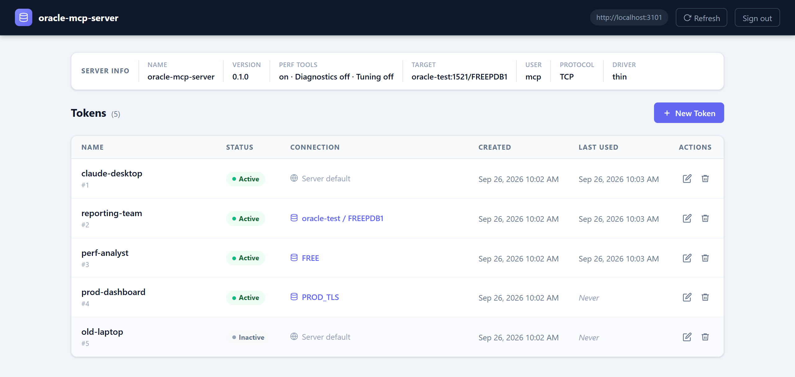
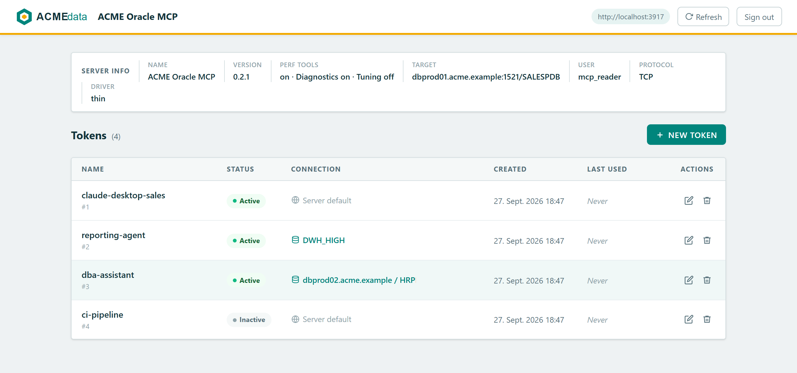
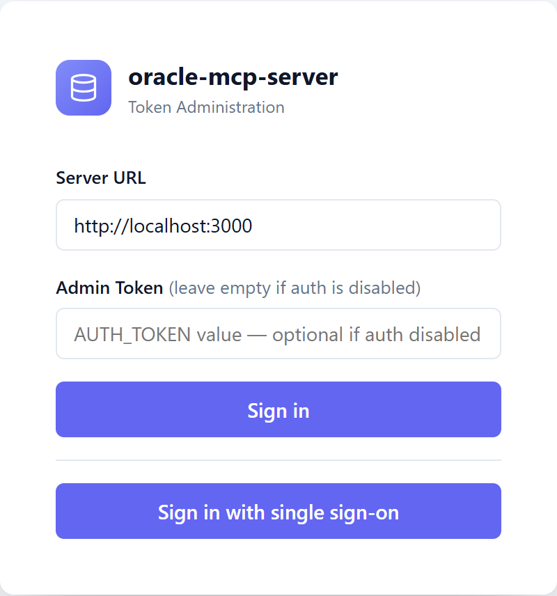
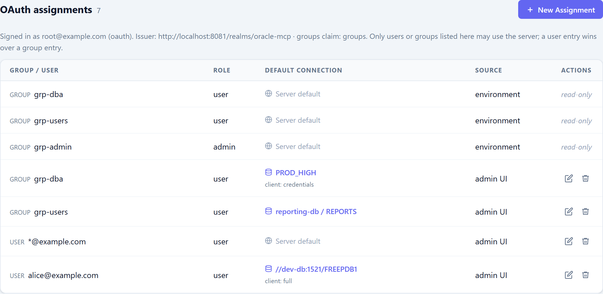
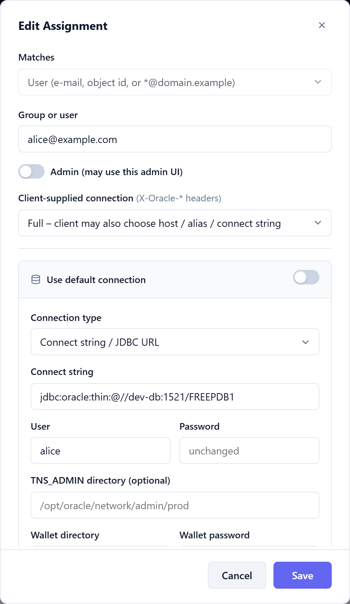
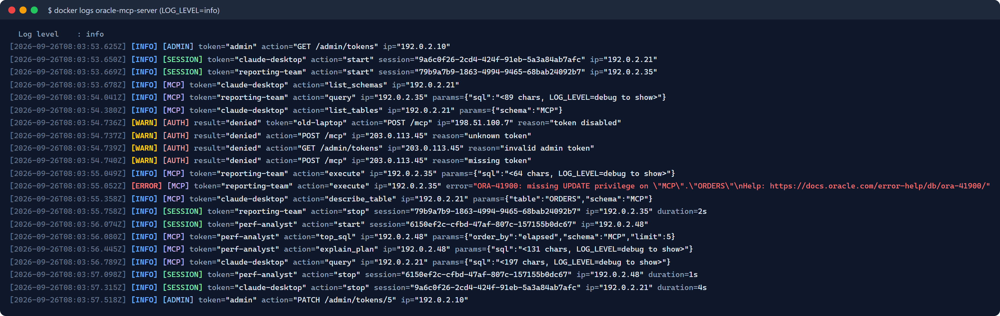

# oracle-mcp-server

Multi-user [Model Context Protocol](https://modelcontextprotocol.io) server for **Oracle Database**:
token auth or OAuth 2.0 / OIDC single sign-on, per-token / per-group database connections, admin UI, audit logging, TLS.
Source & full documentation: https://github.com/tommi2day/oracle-mcp-server

Gives AI tools (Claude, Copilot, Cursor and other MCP clients) SQL access to any Oracle Database. Choose it when
several people or AI clients share Oracle access through **one central service**: revocable tokens or your
company's single sign-on (Entra ID, Keycloak, …) instead of database passwords in every client config, group-based
access to different databases, TCPS wallets kept on the server, and an audit trail that names the person in both the
log and `V$SESSION` (`CLIENT_IDENTIFIER` = token name or the user's e-mail). For a single developer working locally,
Oracle's SQLcl MCP server (`sql -mcp`) needs no extra service
([comparison](https://github.com/Tommi2Day/oracle-mcp-server#when-to-choose-this-server)).

## Tags

- `latest`, `<version>` — thin mode (pure JavaScript driver, no Oracle Client)
- `latest-thick`, `<version>-thick` — with Oracle Instant Client for thick mode (`ORA_DRIVER_MODE=thick`)

## Connection methods

- host / port / service name or SID (`ORA_HOST`, `ORA_PORT`, `ORA_SERVICE_NAME`/`ORA_SID`)
- TNS alias from `tnsnames.ora` (`ORA_TNS_ALIAS`)
- free connect string: Easy Connect Plus, connect descriptor or **JDBC URL** (`ORA_CONNECT_STRING`)
- SQL*Net **TCP** or **TCPS** (`ORA_PROTOCOL=tcps`, wallets, server DN matching, private CAs)

## Quick start

```bash
docker run -d -p 3000:3000 \
  -e AUTH_TOKEN=$(openssl rand -hex 32) \
  -e ORA_CONNECT_STRING='jdbc:oracle:thin:@//db.example.com:1521/ORCLPDB1' \
  -e ORA_USER=app -e ORA_PASSWORD=secret \
  -v "$PWD/tns_admin:/opt/oracle/network/admin:ro" \
  -v oracle-mcp-data:/data \
  tommi2day/oracle-mcp-server
```

`/opt/oracle/network/admin` (= `TNS_ADMIN`) takes `tnsnames.ora`, `sqlnet.ora` (thick mode),
`ewallet.pem` (thin mode wallet or trusted CA certificates) and `cwallet.sso` (thick mode).
In Kubernetes mount them from a Secret/ConfigMap (Helm chart: `tnsAdmin.existingSecret`).

## Endpoints

| Path | Description |
|------|-------------|
| `/mcp` | MCP Streamable HTTP (Bearer token or OAuth access token); optional `X-Oracle-User` / `X-Oracle-Password` / `X-Oracle-Host` … headers if the token allows [client-supplied connections](https://github.com/Tommi2Day/oracle-mcp-server#client-supplied-connections) |
| `/admin` | Admin UI for tokens and per-token connections |
| `/admin/tokens` | Token REST API (admin token) |
| `/info` | Server info and default connection (admin token) |
| `/health` | Health check |

## Tools

`query` (read-only SELECT), `execute` (DML/DDL/PL/SQL with DBMS_OUTPUT), `list_tables`, `describe_table`,
`list_schemas`, `test_connection`.

Performance analysis: `explain_plan`, `sql_plan`, `top_sql`, `session_activity`, `table_stats`, `db_overview`,
`locks`, `alert_log`, `incidents`, `trace_files`, `trace_content`; with
`ORA_DIAGNOSTICS_PACK=true` also `ash_top`, `awr_top_events`, with `ORA_TUNING_PACK=true` `sql_monitor`.
Licensed tools are **off by default** and can be switched per token.

## Claude skills

Six ready-made [Claude Code skills](https://github.com/Tommi2Day/oracle-mcp-server/blob/main/docs/skills.md) in the
repository's `skills/` directory use these tools for typical DBA questions: database status ("what is my database
doing?"), top sessions and SQL, problem detection (locks, waits), SQL tuning, schema documentation and error
analysis with alert log and trace files. Read-only; copy them to `~/.claude/skills`.

## Admin UI

Manage tokens and their database connections (host/service, TNS alias, connect string, TCPS) at `/admin`
([more screenshots](https://github.com/Tommi2Day/oracle-mcp-server#admin-ui)):



Switch it to your corporate design with `ADMIN_LOGO` (logo file or URL) and `ADMIN_THEME_CSS` (overrides the color
variables) — see [Admin UI branding](https://github.com/Tommi2Day/oracle-mcp-server#admin-ui-branding):



## OAuth assignments

With `OAUTH_ISSUER` set, the admin UI offers single sign-on and assigns groups and users to database connections:

<table>
  <tr>
    <td width="35%" valign="top"><b>Login with single sign-on</b> next to the token login<br></td>
    <td width="65%" valign="top"><b>OAuth assignments</b> — groups and users mapped to a default connection; <i>environment</i> entries come from <code>OAUTH_*</code> and are read-only<br></td>
  </tr>
</table>

<details>
<summary>Edit assignment: user, admin role, client-supplied connection and default connection</summary>



</details>

## Audit logging

All activity is written to stderr (`docker logs oracle-mcp-server`): tool calls, session start/stop, rejected logins
and admin actions. SQL text is only logged at `LOG_LEVEL=debug`.



## Environment variables

All settings are environment variables (Docker `-e`, `docker-compose.yml`, Helm `values.yaml`, or the `env` block of a
stdio client config). Variables marked *(per token)* can be overridden per token or OAuth assignment in the admin UI /
token store; the value here is the server default.

### Server

| Variable | Default | Description |
|----------|---------|-------------|
| `TRANSPORT` | `stdio` (image: `http`) | `stdio`: one client over stdin/stdout (Claude Desktop, local CLI). `http`: Streamable HTTP server for many clients, with auth, admin UI and `/health` |
| `PORT` | `3000` | Listen port of the HTTP(S) server (`TRANSPORT=http`) |
| `AUTH_TOKEN` | – | Admin bearer token: full access to `/mcp`, `/admin` and `/info`, uses the server default connection. If empty **and** no token file / OAuth is configured there is no authentication (development only) |
| `TOKENS_FILE` | `./tokens.json` (image: `/data/tokens.json`) | JSON token store (tokens, per-token connections, OAuth assignments); created on first write, mount a volume to keep it |
| `STORE_ENCRYPTION_KEY` | – | Passphrase; encrypts `password` / `wallet_password` in the token store with AES-256-GCM. Without it secrets are stored in clear text; changing it makes existing secrets unreadable |
| `MCP_SERVER_NAME` | `oracle-mcp-server` | Name announced to MCP clients, shown in the admin UI and written to `MODULE` in `V$SESSION` ([session identification](https://github.com/Tommi2Day/oracle-mcp-server#session-identification)) |
| `ORA_CLIENT_CONNECTION` | `none` | `none` \| `credentials` \| `full`: connection parameters that clients of the `AUTH_TOKEN` (or anonymous access) may send as `X-Oracle-*` headers. Tokens and OAuth assignments have their own `client_connection` ([details](https://github.com/Tommi2Day/oracle-mcp-server#client-supplied-connections)) |
| `LOG_LEVEL` | `info` | `debug` \| `info` \| `warn` \| `error`; SQL text is only logged at `debug` ([logging](https://github.com/Tommi2Day/oracle-mcp-server/blob/main/docs/logging.md)) |
| `ADMIN_THEME_CSS` | – | CSS file loaded after the built-in admin UI styles ([branding](https://github.com/Tommi2Day/oracle-mcp-server#admin-ui-branding)) |
| `ADMIN_LOGO` | – | Admin UI logo: file (`.svg` `.png` `.jpg` `.gif` `.webp`, embedded) or `http(s)://` URL |

### TLS for the MCP endpoint

| Variable | Default | Description |
|----------|---------|-------------|
| `TLS_ENABLED` | `false` | Serve HTTPS instead of HTTP. Unrelated to `ORA_PROTOCOL=tcps` (the database connection) |
| `TLS_CERT_FILE` / `TLS_KEY_FILE` | `/certs/tls.crt` / `/certs/tls.key` | Server certificate and key (PEM); a self-signed certificate is generated if the files are missing |
| `TLS_CA_FILE` | – | CA for client certificates; setting it requires a client certificate (mTLS) on the MCP endpoint |
| `TLS_SAN` | – | Extra subject alternative names (comma separated DNS names / IPs) of the generated self-signed certificate |

### Oracle

Target precedence: `ORA_CONNECT_STRING` > `ORA_TNS_ALIAS` > `ORA_HOST`/`ORA_PORT`/service ([details](https://github.com/Tommi2Day/oracle-mcp-server#connection-methods)).

| Variable | Default | Description |
|----------|---------|-------------|
| `ORA_CONNECT_STRING` | – | Free connect string: Easy Connect Plus (`host:port/service`), connect descriptor, or JDBC URL (`jdbc:oracle:thin:@//host:1521/service`). *(per token)* |
| `ORA_TNS_ALIAS` | – | Alias from `tnsnames.ora` in `TNS_ADMIN`. *(per token)* |
| `ORA_HOST` | `localhost` | Database host (used if neither connect string nor alias is set). *(per token)* |
| `ORA_PORT` | `1521` | Listener port. *(per token)* |
| `ORA_SERVICE_NAME` | – | Service name (e.g. the PDB service `FREEPDB1`). *(per token)* |
| `ORA_SID` | – | SID, only for old databases without a service name. *(per token)* |
| `ORA_PROTOCOL` | `tcp` | `tcp` or `tcps` (TLS to the listener, usually port 1522). *(per token)* |
| `ORA_USER` / `ORA_PASSWORD` | – | Default database account for `AUTH_TOKEN`, anonymous access and tokens/assignments without their own user. Use a dedicated low-privilege account |
| `ORA_PASSWORD_FILE` | – | Read the password from this file instead of `ORA_PASSWORD` (Docker/Kubernetes secrets) |
| `TNS_ADMIN` | image: `/opt/oracle/network/admin` | Directory with `tnsnames.ora`, `sqlnet.ora` and wallets ([details](https://github.com/Tommi2Day/oracle-mcp-server#oracle-client-files-tns_admin)). *(per token)* |
| `ORA_WALLET_LOCATION` | `TNS_ADMIN` if it contains `ewallet.pem` | Wallet directory for TCPS (thin: `ewallet.pem`, thick: `cwallet.sso`). *(per token)* |
| `ORA_WALLET_PASSWORD` | – | Password of an encrypted `ewallet.pem`. *(per token)* |
| `ORA_SSL_SERVER_DN_MATCH` | driver default (`true`) | Verify host name / certificate DN on TCPS; `false` only for tests. *(per token)* |
| `ORA_SSL_SERVER_CERT_DN` | – | Expected DN of the server certificate when it differs from the host name. *(per token)* |
| `ORA_TLS_CA_FILE` | – | PEM bundle with additional trusted CA certificates for TCPS (private CAs); added to the process-wide trust store |
| `ORA_DRIVER_MODE` | `thin` | `thin` (pure JavaScript) or `thick` (needs Oracle Instant Client, e.g. image tag `-thick`; required for `cwallet.sso` and native network encryption) |
| `ORA_CLIENT_LIB_DIR` | image: `/opt/oracle/instantclient` (thick image) | Instant Client directory for thick mode |
| `ORA_POOL_MAX` | `5` | Maximum connections per pool; tokens with an identical effective connection share one pool |
| `ORA_CONNECT_TIMEOUT` | `10` | Seconds to wait for establishing a connection |
| `ORA_MAX_ROWS` | `200` | Maximum rows returned by the `query` tool |
| `ORA_PERF_TOOLS` | `true` | `false` hides all performance tools (`explain_plan`, `top_sql`, `locks`, …) |
| `ORA_DIAGNOSTICS_PACK` | `false` | `true` only with a **Diagnostics Pack licence**: enables `ash_top`, `awr_top_events`. *(per token)* |
| `ORA_TUNING_PACK` | `false` | `true` only with a **Tuning Pack licence**: enables `sql_monitor`. *(per token)* |

### OAuth 2.0 / OIDC

`OAUTH_ISSUER` switches OAuth on; the other variables tune it. Examples: [OAuth section](https://github.com/Tommi2Day/oracle-mcp-server#oauth-20--openid-connect)
and [docs/oauth.md](https://github.com/Tommi2Day/oracle-mcp-server/blob/main/docs/oauth.md).

| Variable | Default | Description |
|----------|---------|-------------|
| `OAUTH_ISSUER` | – | Issuer URL (`<issuer>/.well-known/openid-configuration` must exist). Entra: `https://login.microsoftonline.com/<tenant-id>/v2.0` |
| `OAUTH_AUDIENCE` | `OAUTH_CLIENT_ID` | Accepted `aud` values of access tokens (comma separated), e.g. `api://<app-id>` |
| `OAUTH_CLIENT_ID` | – | App registration / client used for the admin UI login (and default audience) |
| `OAUTH_CLIENT_SECRET` | – | Client secret of the browser login; omit for public clients (PKCE is always used) |
| `OAUTH_PUBLIC_URL` | – | External base URL of this server (`https://mcp.example.com`). Redirect URI = `<url>/auth/callback`; `https` marks the session cookie `Secure`. Needed for browser login and the protected-resource metadata |
| `OAUTH_RESOURCE_SCOPES` | `<audience>/.default` | Scopes advertised to MCP clients (space or comma separated); right for Entra, use e.g. `openid profile email` for Keycloak |
| `OAUTH_REDIRECT_URI` | `<OAUTH_PUBLIC_URL>/auth/callback` | Explicit redirect URI if it must differ |
| `OAUTH_SCOPES` | `openid profile email` | Scopes requested by the admin UI login |
| `OAUTH_GROUPS_CLAIM` | `groups` | Claim holding the groups; dotted paths (`realm_access.roles`) and `roles` (Entra app roles) work |
| `OAUTH_EMAIL_CLAIM` | – | Claim with the e-mail; default fallback chain `email`, `preferred_username`, `upn` |
| `OAUTH_ALLOWED_ISSUERS` | `OAUTH_ISSUER` | Accepted `iss` values (comma separated), e.g. Entra v1 tokens `https://sts.windows.net/<tenant>/` |
| `OAUTH_JWKS_URI` / `OAUTH_AUTHORIZATION_ENDPOINT` / `OAUTH_TOKEN_ENDPOINT` | discovery | Override single entries of the discovery document (e.g. when the server reaches the provider under another host name than browsers do) |
| `OAUTH_REQUIRE_VERIFIED_EMAIL` | `false` | `true`: only trust e-mails the provider marks `email_verified: true`. Leave off for Entra (it does not send the claim) |
| `OAUTH_SESSION_TTL` | `28800` | Lifetime of the admin UI session in seconds |
| `OAUTH_ALLOWED_GROUPS` / `OAUTH_ALLOWED_USERS` | – | Comma separated groups / e-mails (`*@example.com` allowed) that may use the server with the default connection; no match = 403 |
| `OAUTH_ADMIN_GROUPS` / `OAUTH_ADMIN_USERS` | – | Same, but they may also use the admin UI and API |
| `OAUTH_ASSIGNMENTS` | – | JSON array of assignments that carry their own connection (`group` or `user`, `tns_alias`, `client_connection`, …), see [docs/oauth.md](https://github.com/Tommi2Day/oracle-mcp-server/blob/main/docs/oauth.md#assignments) |

Full documentation: https://github.com/Tommi2Day/oracle-mcp-server#configuration-reference

## License

MIT — see https://github.com/Tommi2Day/oracle-mcp-server/blob/main/LICENSE
