# oracle-mcp-server

[](https://github.com/Tommi2Day/oracle-mcp-server/actions/workflows/ci.yml)
[](https://codecov.io/gh/Tommi2Day/oracle-mcp-server)
[](https://github.com/Tommi2Day/oracle-mcp-server/releases)
[](https://hub.docker.com/r/tommi2day/oracle-mcp-server)
[](LICENSE)

[Model Context Protocol](https://modelcontextprotocol.io) server that gives AI tools (Claude, Copilot, Cursor and
other MCP clients) access to **Oracle Database** — the Oracle sibling of
[tommi2day/pg-mcp-server](https://github.com/tommi2day/pg-mcp-server).

## Features

- **20 tools:** schema browsing (`list_schemas`, `list_tables`, `describe_table`), read-only `query`, `execute` for
  DML/DDL/PL/SQL with `DBMS_OUTPUT`, and performance analysis (execution plans, top SQL, sessions, locks, optimizer
  statistics, alert log and trace files; ASH/AWR and SQL Monitor only when the packs are licensed) — [details](#tools)
- **Claude skills:** six ready-made workflows — database status, top sessions and SQL, problem detection, SQL
  tuning, documentation and error analysis incl. alert and trace logs — [details](#claude-skills); their steps are
  tested against a real database (blocking chain, slow statement, deadlock → alert log → trace file)
- **Safe reads:** `query` runs in `SET TRANSACTION READ ONLY` and is always rolled back, so Oracle itself rejects
  writes; only `SELECT`/`WITH` are accepted (DDL would commit implicitly); results capped at 200 rows
  (`ORA_MAX_ROWS`) to keep the LLM context small
- **Every Oracle connection style:** host/port/service or SID, TNS alias from `tnsnames.ora`, Easy Connect Plus,
  full descriptors and **JDBC URLs**; plain **TCP** or **TCPS** with wallets, private CAs and server DN pinning;
  node-oracledb *thin* mode (no client install) or *thick* mode (Instant Client image variant)
- **Multi-user:** bearer tokens (admin and client), **one database connection per token**, managed at runtime in a
  web admin UI ([screenshots](#admin-ui)), REST API or `admincli.sh`; DB and wallet passwords encrypted at rest;
  admin UI with your own logo and colors ([branding](#admin-ui-branding)); optionally clients log in with their own
  database account or choose the database ([client-supplied connections](#client-supplied-connections))
- **Single sign-on:** optional **OAuth 2.0 / OpenID Connect** (Microsoft Entra ID, Keycloak, …) — MCP clients send
  an access token, the admin UI offers SSO, and **groups or e-mails choose the default database connection**
  (deny by default) — [details](#oauth-20--openid-connect)
- **Traceable in the database:** each session carries `MODULE`, `ACTION` = tool and `CLIENT_IDENTIFIER` = token
  name or, with SSO, the user's e-mail ([Session identification](#session-identification)); plus a structured audit log of tool calls, sessions,
  rejected logins and admin actions ([example](#logging))
- **Transport & operations:** stdio or Streamable HTTP/HTTPS (optional mTLS), Docker image, docker compose with an
  Oracle Free test database, Helm chart (existing Secrets, `TNS_ADMIN` from Secrets/ConfigMaps, ingress, HPA,
  non-root); only two runtime dependencies (MCP SDK, `oracledb`)

### When to choose this server

Choose it when **several people or AI clients share Oracle access through one central service** — with
revocable tokens or your company's single sign-on (Entra ID, Keycloak, …) instead of database passwords in every client
config, group-based access to different databases, TCPS wallets kept on the server, and an audit trail that names
the person in both the log and `V$SESSION`.

- **No credentials on laptops.** Clients get a token or log in with their corporate account; database users,
  passwords, wallets and `tnsnames.ora` stay on the server.
- **Access follows your directory.** With OAuth/OIDC an assignment maps an Entra/Keycloak group or e-mail to a
  database connection (read-only reporting user for most, a DBA account for a few), deny by default; joiners and leavers are
  handled in the identity provider.
- **Attributable.** The shared database account is not what DBAs see: `CLIENT_IDENTIFIER` carries the user's e-mail
  (or the token name), `ACTION` the tool, next to `[AUDIT]` log lines for logins, sessions and admin changes.
- **Diagnostics included.** Skills and tools for "what is my database doing", locks, top SQL, plans, alert log and
  trace files — read-only, licence-aware (ASH/AWR/SQL Monitor only when licensed).
- **Verified against real components.** Besides unit tests, CI runs every tool, the skills' workflows and the OAuth
  path against an Oracle Free container and a real identity provider (Keycloak, login form included).

| | Local Oracle MCP servers (e.g. SQLcl `sql -mcp`) | oracle-mcp-server |
|---|---|---|
| Deployment | Process per user on the workstation (stdio) | Central service (Docker / Kubernetes) plus stdio |
| Client authentication | Whoever can start it | Bearer tokens, revocable at runtime, or OAuth 2.0 / OIDC single sign-on |
| Who may use which database | The user's own saved connections | Per token, or per directory group / e-mail (OAuth assignments), deny by default |
| Credentials & wallets | On every client machine | Stay on the server; clients only get a token |
| Databases per instance | Saved connections of that user | One connection per token, managed centrally |
| Audit | Log table `DBTOOLS$MCP_LOG` and `V$SESSION` | Server log (token or user e-mail, tool, client IP, rejected logins, `[AUDIT]` trail) and `CLIENT_IDENTIFIER` / `ACTION` in `V$SESSION` |

**When to choose something else:** for a single developer working locally with SQLcl anyway, Oracle's
[SQLcl MCP Server](https://docs.oracle.com/en/database/oracle/sql-developer-command-line/25.2/sqcug/using-oracle-sqlcl-mcp-server.html)
needs no extra service. On Autonomous AI Database, the built-in
[Autonomous AI Database MCP Server](https://docs.oracle.com/en-us/iaas/autonomous-database-serverless/doc/about-mcp-server.html)
exposes Select AI Agent tools with OAuth. For several database engines behind one server, look at
[DBHub](https://github.com/bytebase/dbhub). oracle-mcp-server focuses on secure, audited, multi-user SQL access to
any Oracle Database (on-premises, cloud, container) — self-hosted, with no Oracle client install needed. It brings
its own authorization (tokens or your identity provider) and does not replace database privileges: whatever the
connection of a token or assignment may do, the client may do — give reporting groups a read-only database user.

---

## Contents

- [Features](#features)
- [Tools](#tools)
- [Quick start](#quick-start)
- [Connection methods](#connection-methods)
- [TCPS / TLS](#tcps--tls)
- [Oracle client files (TNS_ADMIN)](#oracle-client-files-tns_admin)
- [Thin vs. thick mode](#thin-vs-thick-mode)
- [Configuration reference](#configuration-reference)
- [Session identification](#session-identification)
- [Tokens & per-token connections](#tokens--per-token-connections)
- [OAuth 2.0 / OpenID Connect](#oauth-20--openid-connect)
- [Logging](#logging)
- [Kubernetes / Helm](#kubernetes--helm)
- [Claude skills](#claude-skills)
- [Claude configuration](#claude-configuration)
- [Development](#development)

---

## Tools

| Tool | Description |
|------|-------------|
| `query` | Read-only `SELECT` / `WITH` query (runs in `SET TRANSACTION READ ONLY`, always rolled back). Bind variables `:1, :2` (array) or `:name` (object). Returns at most `ORA_MAX_ROWS` rows (default 200). |
| `execute` | DML, DDL, `MERGE` or PL/SQL block; committed. Returns rows affected and the `DBMS_OUTPUT` of PL/SQL blocks. |
| `list_tables` | Tables, views and materialized views of a schema (default: current schema). |
| `describe_table` | Columns, Oracle types (`VARCHAR2(50 CHAR)`, `NUMBER(10,2)` …), nullability, defaults, PK and column comments. |
| `list_schemas` | Schemas visible to the user (Oracle-maintained schemas hidden unless `include_system: true`). |
| `test_connection` | Database/PDB name, service, user, server version, driver mode and whether the session uses TCPS. |

Identifiers follow Oracle rules: unquoted names are upper-cased (`emp` → `EMP`), `"MixedCase"` is used verbatim.
A trailing `;` on SQL statements and a trailing SQL*Plus `/` on PL/SQL blocks are stripped automatically.

> The `query` tool rejects anything that is not `SELECT`/`WITH` because DDL would implicitly commit and end
> the read-only transaction. For hard guarantees, connect with a read-only database user.

### Performance analysis

| Tool | Description | Licence |
|------|-------------|---------|
| `explain_plan` | Optimizer plan of a SELECT/WITH/INSERT/UPDATE/DELETE/MERGE (`EXPLAIN PLAN` + `DBMS_XPLAN.DISPLAY`) without executing it; bind variables may stay unbound. | – |
| `sql_plan` | Actual plan of a cached cursor by `sql_id` (`DBMS_XPLAN.DISPLAY_CURSOR`); `format: "ALLSTATS LAST"` for row source statistics. | – |
| `top_sql` | Top statements from `V$SQLAREA` by elapsed, CPU, buffer gets, disk reads, executions or elapsed per execution; filter by schema / text. | – |
| `session_activity` | Active sessions (`V$SESSION`) with sql_id, wait event and blocker, plus top non-idle wait events since startup. | – |
| `table_stats` | Table, index and column optimizer statistics incl. staleness, clustering factor and histograms. | – |
| `db_overview` | "What is my database doing": instance, load of the last minute, sessions, CPU vs. wait classes, attention points. | – |
| `locks` | Blocked sessions, root blockers (status, idle time, waiters), locked objects; suggests but never runs `KILL SESSION`. | – |
| `alert_log` | Alert log via `V$DIAG_ALERT_EXT`: recent entries, only errors, or containing a text; shows the trace file of an error. | – (log privileges) |
| `incidents` | ADR incidents (`V$DIAG_INCIDENT`, `V$DIAG_PROBLEM`): time, error code, problem key. | – (log privileges) |
| `trace_files`, `trace_content` | List and read trace files (`V$DIAG_TRACE_FILE[_CONTENTS]`), head/tail/filter. May contain SQL text and data. | – (log privileges) |
| `ash_top` | Active Session History of the last N minutes grouped by sql_id, event, wait class, session or module. | **Diagnostics Pack** |
| `awr_top_events` | DB time, DB CPU and top wait events between the first and last AWR snapshot of the last N hours. | **Diagnostics Pack** |
| `sql_monitor` | Recent monitored executions (`V$SQL_MONITOR`) or the text report of one `sql_id`. | **Tuning Pack** |

The alert log and trace tools need the optional log privileges (`@grant_perf_privileges.sql <user> MINIMAL N N Y`,
role `MCP_PERF_LOG_ROLE`, or `SELECT_CATALOG_ROLE`); without them they answer with a privilege hint.
The [Claude skills](#claude-skills) combine these tools into ready-made workflows.

**Licensed features are disabled by default.** Tools that need an Oracle management pack are neither listed to
the client nor executable unless enabled:

| Switch | Default | Scope |
|--------|---------|-------|
| `ORA_PERF_TOOLS` | `true` | `false` hides all performance tools (global) |
| `ORA_DIAGNOSTICS_PACK` | `false` | enables `ash_top`, `awr_top_events` |
| `ORA_TUNING_PACK` | `false` | enables `sql_monitor` (Oracle licenses the Tuning Pack only together with the Diagnostics Pack) |

Tokens can override the pack switches for their connection (`diagnostics_pack` / `tuning_pack`, admin UI or
`admincli.sh add-token … --diagnostics-pack true`), so one server can serve licensed and unlicensed databases.
If the database itself has `CONTROL_MANAGEMENT_PACK_ACCESS` set to `NONE`, the tools say so when they find no data.

> The switches only control this server's tools. The generic `query` tool can still read any view the database
> user is allowed to see — revoke access to `V$ACTIVE_SESSION_HISTORY`, `DBA_HIST_*` and `V$SQL_MONITOR` on the
> database side if pack usage must be prevented technically.

Privileges: the unlicensed tools except `explain_plan` read dynamic performance views. Run
`scripts/sql/grant_perf_privileges.sql <user> [MINIMAL|CATALOG] [diagnostics Y|N] [tuning Y|N] [logs Y|N]` as SYS — in
`MINIMAL` mode it creates separate roles for the unlicensed tools, each pack and the alert log / trace tools, so
licensed views are only reachable where the pack is granted. Errors caused by missing privileges include a hint.
**Full documentation of the tools, privileges and the grant script: [docs/performance.md](docs/performance.md).** In a PDB, `awr_top_events` uses the PDB's own snapshots (`AWR_PDB_AUTOFLUSH_ENABLED=TRUE`) and
otherwise falls back to CDB root snapshots where their statistics are visible.

Internal statements of the performance tools run with `ACTION=mcp-perf:<tool>` and are excluded from `top_sql`
(see [Session identification](#session-identification)).

---

## Quick start

### docker compose (with a local Oracle Free test database)

```bash
cp .env.example .env            # set AUTH_TOKEN (openssl rand -hex 32)
docker compose up -d            # Oracle Free 23ai + MCP server on http://localhost:3000
./scripts/test_token.sh "$AUTH_TOKEN"
```

`examples/tns_admin/` is mounted as `TNS_ADMIN`; its `tnsnames.ora` defines the alias `FREE` for the test database.

### docker run

```bash
docker run -d --name oracle-mcp-server -p 3000:3000 \
  -e AUTH_TOKEN=$(openssl rand -hex 32) \
  -e ORA_CONNECT_STRING='jdbc:oracle:thin:@//db.example.com:1521/ORCLPDB1' \
  -e ORA_USER=app -e ORA_PASSWORD=secret \
  -v "$PWD/tns_admin:/opt/oracle/network/admin:ro" \
  -v oracle-mcp-data:/data \
  tommi2day/oracle-mcp-server
```

or `./scripts/run.sh` (reads `.env`, generates `./auth_token`, mounts `./tns_admin` if present).

### Local (stdio, Claude Desktop)

```bash
npm ci && npm run build
ORA_HOST=localhost ORA_SERVICE_NAME=FREEPDB1 ORA_USER=mcp ORA_PASSWORD=mcp_pw node dist/index.js
```

---

## Connection methods

The default connection is built from `ORA_*` environment variables; each token can override it
(see [per-token connections](#tokens--per-token-connections)). The target is chosen by precedence:

| # | Method | Env var(s) | Token field(s) |
|---|--------|-----------|----------------|
| 1 | Free connect string / JDBC URL | `ORA_CONNECT_STRING` | `connect_string` |
| 2 | TNS alias | `ORA_TNS_ALIAS` (+ `TNS_ADMIN`) | `tns_alias` (+ `tns_admin`) |
| 3 | Host / port / service | `ORA_HOST`, `ORA_PORT` (1521), `ORA_SERVICE_NAME` or `ORA_SID`, `ORA_PROTOCOL` (`tcp`\|`tcps`) | `host`, `port`, `service_name`, `sid`, `protocol` |

Credentials: `ORA_USER` / `ORA_PASSWORD` (or `ORA_PASSWORD_FILE`).

### Accepted connect strings

| Input | Used as |
|-------|---------|
| `db:1521/ORCLPDB1`, `//db:1521/ORCLPDB1` | Easy Connect |
| `tcps://db:2484/ORCLPDB1?ssl_server_dn_match=true` | Easy Connect Plus (parameters passed through) |
| `(DESCRIPTION=(ADDRESS=(PROTOCOL=TCPS)(HOST=db)(PORT=2484))(CONNECT_DATA=(SERVICE_NAME=svc)))` | Connect descriptor |
| `PROD_HIGH` | TNS alias |
| `jdbc:oracle:thin:@//db:1521/ORCLPDB1`, `jdbc:oracle:thin:@db:1521/ORCLPDB1` | → Easy Connect |
| `jdbc:oracle:thin:@db:1521:ORCL` | legacy **SID** syntax → descriptor with `(SID=ORCL)` |
| `jdbc:oracle:thin:@tcps://db:2484/svc` | → Easy Connect Plus (TCPS) |
| `jdbc:oracle:thin:@(DESCRIPTION=…)` | → descriptor |
| `jdbc:oracle:thin:@prod_high?TNS_ADMIN=/opt/oracle/wallets/prod` | → alias, `TNS_ADMIN` used as config/wallet dir |
| `jdbc:oracle:thin:scott/tiger@…` | credentials extracted (for tokens they are moved into the encrypted password field) |

JDBC-only driver properties (`oracle.net.*`, `oracle.jdbc.*`) are ignored with a warning.

---

## TCPS / TLS

TCPS works with every connection method: `ORA_PROTOCOL=tcps`, a `tcps://` connect string or
`(PROTOCOL=TCPS)` in a descriptor/alias.

| Situation | What to provide |
|-----------|-----------------|
| Server certificate from a public CA | nothing — the system CA store is used |
| Server certificate from a **private CA** | CA certificate(s) as `ewallet.pem` in `TNS_ADMIN` (or `wallet_location`), or a PEM bundle via `ORA_TLS_CA_FILE` |
| **Mutual TLS** / Autonomous Database wallet | `ewallet.pem` containing private key + certificates in `TNS_ADMIN` or `ORA_WALLET_LOCATION`; `ORA_WALLET_PASSWORD` if it is encrypted |
| Thick mode | `cwallet.sso` (auto-login wallet) + `sqlnet.ora` `WALLET_LOCATION` in `TNS_ADMIN` |

How `ewallet.pem` is used (thin mode):

- contains a **private key** → passed to the driver as wallet (client certificate + trusted CAs)
- contains **certificates only** → added to the process-wide set of trusted CAs
  (node-oracledb thin cannot load a certificate-only file as wallet)

Server identity checks: host name / SAN matching is on by default (`ORA_SSL_SERVER_DN_MATCH=false` or
token `ssl_server_dn_match: false` to disable), `ORA_SSL_SERVER_CERT_DN` / `(SECURITY=(SSL_SERVER_CERT_DN=…))`
pins the certificate subject.

Converting wallets for thin mode:

```bash
# PKCS#12 wallet (ewallet.p12) → PEM (keeps key and certificates)
openssl pkcs12 -in ewallet.p12 -out ewallet.pem -nodes            # unencrypted
openssl pkcs12 -in ewallet.p12 -out ewallet.pem -passout pass:xyz  # encrypted → ORA_WALLET_PASSWORD=xyz
# Trust-only: just the CA certificate
cp root-ca.crt tns_admin/ewallet.pem
```

---

## Oracle client files (TNS_ADMIN)

In the image `TNS_ADMIN=/opt/oracle/network/admin` (declared as `VOLUME`). Mount your files read-only:

```text
tns_admin/
├── tnsnames.ora     # aliases (thin + thick)
├── sqlnet.ora       # thick mode only (thin mode ignores sqlnet.ora)
├── ewallet.pem      # thin mode wallet or trusted CA certificates
└── cwallet.sso      # thick mode auto-login wallet
```

- **Docker:** `-v ./tns_admin:/opt/oracle/network/admin:ro` (files must be readable by uid 1000)
- **Kubernetes:** Secret and/or ConfigMap, combined into one directory by the Helm chart:

  ```bash
  kubectl -n mcp create secret generic oracle-tns-admin \
    --from-file=tnsnames.ora --from-file=sqlnet.ora --from-file=ewallet.pem
  helm install oracle-mcp ./helm/oracle-mcp-server -n mcp --set tnsAdmin.existingSecret=oracle-tns-admin …
  ```

Different tokens can use different client configurations: mount additional directories (Helm
`tnsAdmin.extraSecrets`) and reference them with the token fields `tns_admin` / `wallet_location`
(thin mode). In thick mode the Oracle Client reads only the global `TNS_ADMIN`.

---

## Thin vs. thick mode

| | thin (default) | thick (`ORA_DRIVER_MODE=thick`) |
|---|---|---|
| Image | `tommi2day/oracle-mcp-server:latest` | `tommi2day/oracle-mcp-server:latest-thick` (built with `--build-arg ORACLE_THICK=true`) |
| Oracle Client | none | Instant Client (basic lite) |
| `tnsnames.ora` | ✅ | ✅ |
| `sqlnet.ora` | ❌ (use `ORA_*` settings) | ✅ |
| Wallet | `ewallet.pem` | `cwallet.sso` / `ewallet.p12` via `sqlnet.ora` |
| Per-token `tns_admin` / wallet | ✅ | ❌ (global `TNS_ADMIN` only) |
| Native network encryption, DB < 12.1 | ❌ | ✅ |

Outside the image set `ORA_CLIENT_LIB_DIR` to the Instant Client directory for thick mode.

---

## Configuration reference

All settings are environment variables (Docker `-e`, `docker-compose.yml`, Helm `values.yaml`, or the `env` block of a
stdio client config). Variables marked *(per token)* can be overridden per token or OAuth assignment in the admin UI /
token store; the value here is the server default.

### Server

| Variable | Default | Description |
|----------|---------|-------------|
| `TRANSPORT` | `stdio` (image: `http`) | `stdio`: one client over stdin/stdout (Claude Desktop, local CLI). `http`: Streamable HTTP server for many clients, with auth, admin UI and `/health` |
| `PORT` | `3000` | Listen port of the HTTP(S) server (`TRANSPORT=http`) |
| `AUTH_TOKEN` | – | Admin bearer token: full access to `/mcp`, `/admin` and `/info`, uses the server default connection. If empty **and** no token file / OAuth is configured there is no authentication (development only) |
| `TOKENS_FILE` | `./tokens.json` (image: `/data/tokens.json`) | JSON token store (tokens, per-token connections, OAuth assignments); created on first write, mount a volume to keep it |
| `STORE_ENCRYPTION_KEY` | – | Passphrase; encrypts `password` / `wallet_password` in the token store with AES-256-GCM. Without it secrets are stored in clear text; changing it makes existing secrets unreadable |
| `MCP_SERVER_NAME` | `oracle-mcp-server` | Name announced to MCP clients, shown in the admin UI and written to `MODULE` in `V$SESSION` ([session identification](#session-identification)) |
| `ORA_CLIENT_CONNECTION` | `none` | `none` \| `credentials` \| `full`: connection parameters that clients of the `AUTH_TOKEN` (or anonymous access) may send as `X-Oracle-*` headers. Tokens and OAuth assignments have their own `client_connection` ([details](#client-supplied-connections)) |
| `LOG_LEVEL` | `info` | `debug` \| `info` \| `warn` \| `error`; SQL text is only logged at `debug` ([logging](docs/logging.md)) |
| `ADMIN_THEME_CSS` | – | CSS file loaded after the built-in admin UI styles ([branding](#admin-ui-branding)) |
| `ADMIN_LOGO` | – | Admin UI logo: file (`.svg` `.png` `.jpg` `.gif` `.webp`, embedded) or `http(s)://` URL |

### TLS for the MCP endpoint

| Variable | Default | Description |
|----------|---------|-------------|
| `TLS_ENABLED` | `false` | Serve HTTPS instead of HTTP. Unrelated to `ORA_PROTOCOL=tcps` (the database connection) |
| `TLS_CERT_FILE` / `TLS_KEY_FILE` | `/certs/tls.crt` / `/certs/tls.key` | Server certificate and key (PEM); a self-signed certificate is generated if the files are missing |
| `TLS_CA_FILE` | – | CA for client certificates; setting it requires a client certificate (mTLS) on the MCP endpoint |
| `TLS_SAN` | – | Extra subject alternative names (comma separated DNS names / IPs) of the generated self-signed certificate |

### Oracle

Target precedence: `ORA_CONNECT_STRING` > `ORA_TNS_ALIAS` > `ORA_HOST`/`ORA_PORT`/service ([details](#connection-methods)).

| Variable | Default | Description |
|----------|---------|-------------|
| `ORA_CONNECT_STRING` | – | Free connect string: Easy Connect Plus (`host:port/service`), connect descriptor, or JDBC URL (`jdbc:oracle:thin:@//host:1521/service`). *(per token)* |
| `ORA_TNS_ALIAS` | – | Alias from `tnsnames.ora` in `TNS_ADMIN`. *(per token)* |
| `ORA_HOST` | `localhost` | Database host (used if neither connect string nor alias is set). *(per token)* |
| `ORA_PORT` | `1521` | Listener port. *(per token)* |
| `ORA_SERVICE_NAME` | – | Service name (e.g. the PDB service `FREEPDB1`). *(per token)* |
| `ORA_SID` | – | SID, only for old databases without a service name. *(per token)* |
| `ORA_PROTOCOL` | `tcp` | `tcp` or `tcps` (TLS to the listener, usually port 1522). *(per token)* |
| `ORA_USER` / `ORA_PASSWORD` | – | Default database account for `AUTH_TOKEN`, anonymous access and tokens/assignments without their own user. Use a dedicated low-privilege account |
| `ORA_PASSWORD_FILE` | – | Read the password from this file instead of `ORA_PASSWORD` (Docker/Kubernetes secrets) |
| `TNS_ADMIN` | image: `/opt/oracle/network/admin` | Directory with `tnsnames.ora`, `sqlnet.ora` and wallets ([details](#oracle-client-files-tns_admin)). *(per token)* |
| `ORA_WALLET_LOCATION` | `TNS_ADMIN` if it contains `ewallet.pem` | Wallet directory for TCPS (thin: `ewallet.pem`, thick: `cwallet.sso`). *(per token)* |
| `ORA_WALLET_PASSWORD` | – | Password of an encrypted `ewallet.pem`. *(per token)* |
| `ORA_SSL_SERVER_DN_MATCH` | driver default (`true`) | Verify host name / certificate DN on TCPS; `false` only for tests. *(per token)* |
| `ORA_SSL_SERVER_CERT_DN` | – | Expected DN of the server certificate when it differs from the host name. *(per token)* |
| `ORA_TLS_CA_FILE` | – | PEM bundle with additional trusted CA certificates for TCPS (private CAs); added to the process-wide trust store |
| `ORA_DRIVER_MODE` | `thin` | `thin` (pure JavaScript) or `thick` (needs Oracle Instant Client, e.g. image tag `-thick`; required for `cwallet.sso` and native network encryption) |
| `ORA_CLIENT_LIB_DIR` | image: `/opt/oracle/instantclient` (thick image) | Instant Client directory for thick mode |
| `ORA_POOL_MAX` | `5` | Maximum connections per pool; tokens with an identical effective connection share one pool |
| `ORA_CONNECT_TIMEOUT` | `10` | Seconds to wait for establishing a connection |
| `ORA_MAX_ROWS` | `200` | Maximum rows returned by the `query` tool |
| `ORA_PERF_TOOLS` | `true` | `false` hides all performance tools (`explain_plan`, `top_sql`, `locks`, …) |
| `ORA_DIAGNOSTICS_PACK` | `false` | `true` only with a **Diagnostics Pack licence**: enables `ash_top`, `awr_top_events`. *(per token)* |
| `ORA_TUNING_PACK` | `false` | `true` only with a **Tuning Pack licence**: enables `sql_monitor`. *(per token)* |

### OAuth 2.0 / OIDC

`OAUTH_ISSUER` switches OAuth on; the other variables tune it. Examples: [OAuth section](#oauth-20--openid-connect)
and [docs/oauth.md](docs/oauth.md).

| Variable | Default | Description |
|----------|---------|-------------|
| `OAUTH_ISSUER` | – | Issuer URL (`<issuer>/.well-known/openid-configuration` must exist). Entra: `https://login.microsoftonline.com/<tenant-id>/v2.0` |
| `OAUTH_AUDIENCE` | `OAUTH_CLIENT_ID` | Accepted `aud` values of access tokens (comma separated), e.g. `api://<app-id>` |
| `OAUTH_CLIENT_ID` | – | App registration / client used for the admin UI login (and default audience) |
| `OAUTH_CLIENT_SECRET` | – | Client secret of the browser login; omit for public clients (PKCE is always used) |
| `OAUTH_PUBLIC_URL` | – | External base URL of this server (`https://mcp.example.com`). Redirect URI = `<url>/auth/callback`; `https` marks the session cookie `Secure`. Needed for browser login and the protected-resource metadata |
| `OAUTH_RESOURCE_SCOPES` | `<audience>/.default` | Scopes advertised to MCP clients (space or comma separated); right for Entra, use e.g. `openid profile email` for Keycloak |
| `OAUTH_REDIRECT_URI` | `<OAUTH_PUBLIC_URL>/auth/callback` | Explicit redirect URI if it must differ |
| `OAUTH_SCOPES` | `openid profile email` | Scopes requested by the admin UI login |
| `OAUTH_GROUPS_CLAIM` | `groups` | Claim holding the groups; dotted paths (`realm_access.roles`) and `roles` (Entra app roles) work |
| `OAUTH_EMAIL_CLAIM` | – | Claim with the e-mail; default fallback chain `email`, `preferred_username`, `upn` |
| `OAUTH_ALLOWED_ISSUERS` | `OAUTH_ISSUER` | Accepted `iss` values (comma separated), e.g. Entra v1 tokens `https://sts.windows.net/<tenant>/` |
| `OAUTH_JWKS_URI` / `OAUTH_AUTHORIZATION_ENDPOINT` / `OAUTH_TOKEN_ENDPOINT` | discovery | Override single entries of the discovery document (e.g. when the server reaches the provider under another host name than browsers do) |
| `OAUTH_REQUIRE_VERIFIED_EMAIL` | `false` | `true`: only trust e-mails the provider marks `email_verified: true`. Leave off for Entra (it does not send the claim) |
| `OAUTH_SESSION_TTL` | `28800` | Lifetime of the admin UI session in seconds |
| `OAUTH_ALLOWED_GROUPS` / `OAUTH_ALLOWED_USERS` | – | Comma separated groups / e-mails (`*@example.com` allowed) that may use the server with the default connection; no match = 403 |
| `OAUTH_ADMIN_GROUPS` / `OAUTH_ADMIN_USERS` | – | Same, but they may also use the admin UI and API |
| `OAUTH_ASSIGNMENTS` | – | JSON array of assignments that carry their own connection (`group` or `user`, `tns_alias`, `client_connection`, …), see [docs/oauth.md](docs/oauth.md#assignments) |

---

## Session identification

Every database session used by the server identifies the MCP server and the token, so DBAs can attribute
activity in `V$SESSION`, ASH, AWR, SQL Monitor and the audit trail:

| `V$SESSION` column | Value | Example |
|--------------------|-------|---------|
| `PROGRAM` | `MCP_SERVER_NAME` (thin mode; characters other than `A-Z a-z 0-9 . _ -` become `_`) | `Prod_DB__EU_` |
| `MODULE` | `MCP_SERVER_NAME` | `Prod DB (EU)` |
| `ACTION` | tool name; `mcp-perf:<tool>` while a performance tool runs its own statements | `query`, `mcp-perf:top_sql` |
| `CLIENT_IDENTIFIER` | token name (`admin` for `AUTH_TOKEN`, `anonymous` without auth, `stdio` in stdio mode, the user's e-mail with [OAuth](#oauth-20--openid-connect)) | `claude-desktop` |
| `CLIENT_INFO` | server name, version and MCP client IP | `Prod DB (EU) 0.1.0 ip=10.0.0.7` |

The attributes are set on every checkout from the pool (tokens with the same effective connection share
sessions) and travel with the next database call — no extra round trip. Values are cut to Oracle's limits
(MODULE 48, ACTION 32, CLIENT_IDENTIFIER / CLIENT_INFO 64 bytes). An idle pooled session keeps the values of its
last use.

```sql
SELECT sid, program, module, action, client_identifier, client_info
FROM   v$session WHERE module = 'Prod DB (EU)';
-- ASH (Diagnostics Pack): DB time per token
SELECT client_id, COUNT(*) FROM v$active_session_history
WHERE  module = 'Prod DB (EU)' GROUP BY client_id;
```

`CLIENT_IDENTIFIER` also appears in unified auditing (`UNIFIED_AUDIT_TRAIL.CLIENT_IDENTIFIER`) and can drive
`DBMS_MONITOR.CLIENT_ID_TRACE_ENABLE` to trace everything a single token does.

---

## Tokens & per-token connections

Tokens are managed in the admin UI (`/admin`), via the REST API (`/admin/tokens`, see `openapi.json`)
or with `scripts/admincli.sh`. The plaintext token is shown once; only its SHA-256 hash is stored.

```bash
export AUTH_TOKEN=<admin token> MCP_URL=http://localhost:3000
./scripts/admincli.sh add-token reporting --host db.example.com --port 2484 --protocol tcps \
    --service REPORTS --user report_ro --password secret
./scripts/admincli.sh add-token prod --tns-alias PROD_HIGH --user app --password secret
./scripts/admincli.sh add-token legacy --connect-string 'jdbc:oracle:thin:@dbhost:1521:ORCL' \
    --user scott --password tiger
./scripts/admincli.sh set-conn 2 '{"tns_alias":"PROD","tns_admin":"/opt/oracle/wallets/prod","user":"app"}'
```

Connection object fields: `connect_string`, `tns_alias`, `host`, `port`, `service_name`, `sid`, `protocol`,
`user`, `password`, `tns_admin`, `wallet_location`, `wallet_password`, `ssl_server_dn_match`, `ssl_server_cert_dn`,
`diagnostics_pack`, `tuning_pack`.

Merge rules with the default connection:

- a token that sets a target (`connect_string`, `tns_alias` or `host`) never inherits target fields of the default
- `user`/`password` fall back to the default only if the token sets no `user`
- `tns_admin`, wallet and TLS fields fall back individually

Secrets are write-only: the API returns `password_set: true` instead of the password, and a `PATCH` without
`password` keeps the stored one. Tokens with the same effective connection share one connection pool.

### Client-supplied connections

By default a client always uses the connection of its token (or the server default). The admin can allow the
clients of a token to send **their own connection parameters** — e.g. so that every user logs in with a personal
database account instead of a shared technical user. The permission is the token field `client_connection`
(admin UI: *Client-supplied connection*, `admincli.sh add-token … --client-connection` / `set-client-conn`):

| `client_connection` | Client may send | Typical use |
|---------------------|-----------------|-------------|
| `none` (default) | nothing — X-Oracle-* headers are rejected with HTTP 403 | fixed connection |
| `credentials` | `user` + `password`; target (host/alias/…) stays the token's or server's | personal DB accounts on one database |
| `full` | additionally the target: `connect_string`, `tns_alias`, `host`, `port`, `service_name`, `sid`, `protocol`, `ssl_server_dn_match`, `ssl_server_cert_dn` | one token for many databases (the server can then reach any host the client names) |

For the `AUTH_TOKEN` admin token (and anonymous access when auth is disabled) `ORA_CLIENT_CONNECTION` sets the
same permission (default `none`).

#### Call format

The parameters are sent as **HTTP headers on the MCP `initialize` request** — the request that opens the MCP
session (no `mcp-session-id` yet). They apply to the whole session; headers on later requests are ignored. Header
name = `X-Oracle-` + field name with `_` → `-` (case-insensitive):

| Header | Field | Mode |
|--------|-------|------|
| `X-Oracle-User`, `X-Oracle-Password` | `user`, `password` — always both | `credentials`, `full` |
| `X-Oracle-Connect-String` | Easy Connect, descriptor or JDBC URL (`jdbc:oracle:thin:user/pw@…` also sets the credentials) | `full` |
| `X-Oracle-Tns-Alias` | alias from the **server's** `tnsnames.ora` | `full` |
| `X-Oracle-Host`, `X-Oracle-Port`, `X-Oracle-Service-Name` / `X-Oracle-Sid`, `X-Oracle-Protocol` | host target (`tcp` / `tcps`) | `full` |
| `X-Oracle-Ssl-Server-Dn-Match`, `X-Oracle-Ssl-Server-Cert-Dn` | TCPS certificate checks | `full` |

```http
POST /mcp HTTP/1.1
Authorization: Bearer <token>
Content-Type: application/json
Accept: application/json, text/event-stream
X-Oracle-User: jdoe
X-Oracle-Password: s3cret
X-Oracle-Host: db2.example.com
X-Oracle-Service-Name: SALESPDB

{"jsonrpc":"2.0","id":1,"method":"initialize","params":{"protocolVersion":"2025-06-18","capabilities":{},
 "clientInfo":{"name":"my-client","version":"1.0"}}}
```

Client configuration — MCP clients send configured headers with every request, so a static header entry is all
that is needed:

```jsonc
// .mcp.json (Claude Code) / any client with Streamable HTTP + headers
{
  "mcpServers": {
    "oracle-sales": {
      "type": "http",
      "url": "https://mcp.example.com/mcp",
      "headers": {
        "Authorization": "Bearer <token>",
        "X-Oracle-User": "jdoe",
        "X-Oracle-Password": "${ORACLE_PASSWORD}"
      }
    }
  }
}
```

```bash
# Claude Code CLI
claude mcp add --transport http oracle-sales https://mcp.example.com/mcp \
  --header "Authorization: Bearer <token>" --header "X-Oracle-User: jdoe" --header "X-Oracle-Password: s3cret"

# Claude Desktop and other stdio-only clients via mcp-remote
npx mcp-remote https://mcp.example.com/mcp --header "Authorization: Bearer <token>" \
  --header "X-Oracle-User: jdoe" --header "X-Oracle-Password: s3cret"
```

Rules and safeguards:

- Client parameters override the token's connection: `user`/`password` replace the token's credentials; a
  client target replaces the token's target (and its `ssl_server_cert_dn` pinning). The token's `tns_admin`, wallet
  and licence switches (`diagnostics_pack`, `tuning_pack`) stay in effect.
- A client target **requires client credentials** — the password of the token or server default is never sent to
  a host chosen by the client.
- Server-side files cannot be referenced: `tns_admin`, `wallet_location` and `wallet_password` are not accepted as
  headers, and connect strings mentioning a wallet or `TNS_ADMIN` are rejected.
- Rejected requests get HTTP 403 (not permitted) or 400 (invalid, e.g. `user` without `password`) with a JSON-RPC
  error message, and are logged as `[AUTH] result="denied" … reason="client connection: …"`. A wrong database
  password shows up as the ORA- error of the first tool call.
- The permission is re-checked on every request: switching a token back to `none` ends the use of client
  parameters in its open sessions immediately.
- Sessions with client parameters get their own connection pool, which is closed when the last such session ends.
  The session start log shows `connection="client" target="…" user="…"` (never the password).
- Passwords travel in HTTP headers — use HTTPS (`TLS_ENABLED=true` or a TLS-terminating ingress).

### Admin UI

Open `http://<server>:3000/admin`, sign in with the server URL and the `AUTH_TOKEN` value (leave it empty if auth
is disabled). The session is kept in `sessionStorage` and cleared when the browser tab is closed.

**Token list** — server info with the default connection and enabled performance features, then every token with
status, connection (server default, host / service or TNS alias) and last use:

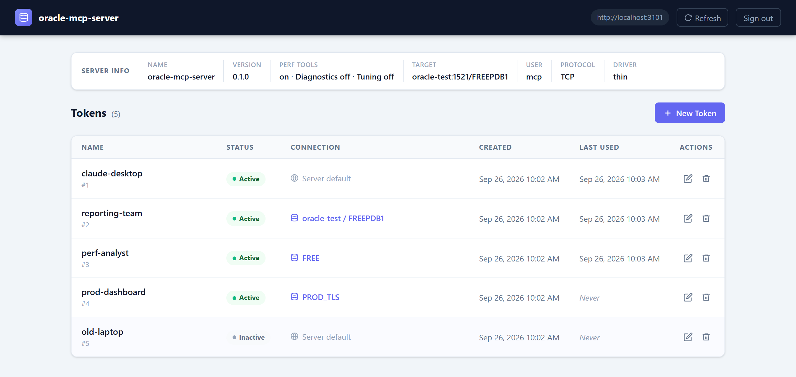

<table>
  <tr>
    <td width="33%" valign="top"><b>Login</b><br>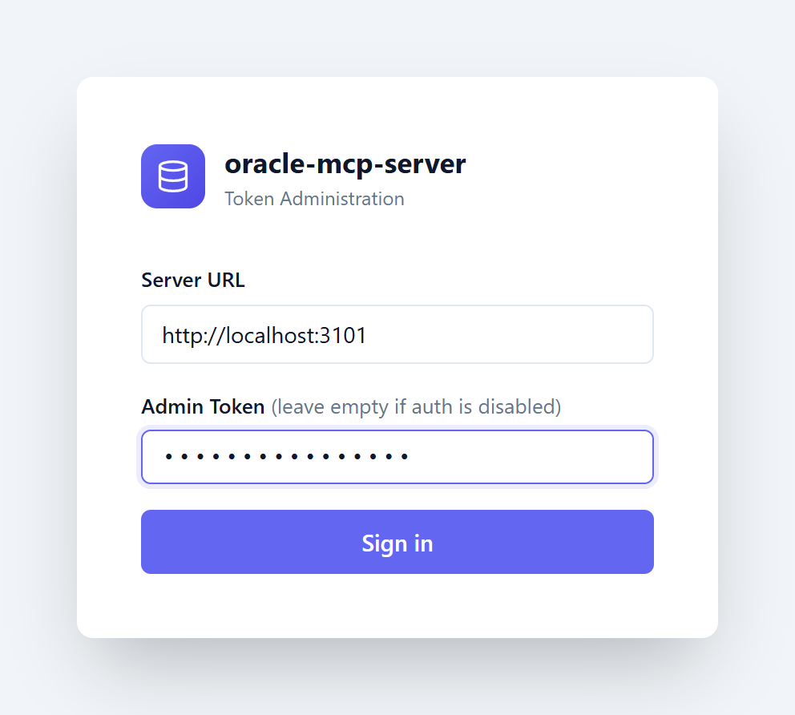</td>
    <td width="33%" valign="top"><b>New token with its own connection</b> — TNS alias over TCPS with server certificate DN pinning; Diagnostics/Tuning Pack per token<br>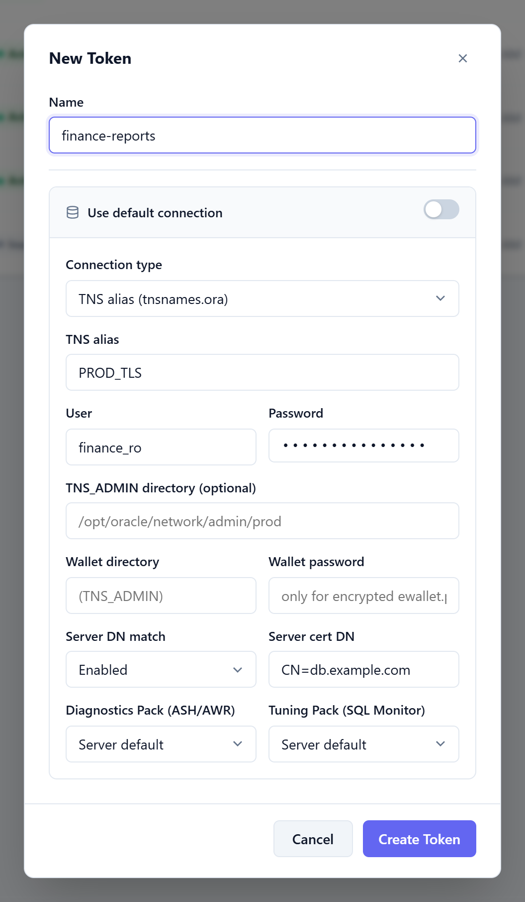</td>
    <td width="33%" valign="top"><b>Token value is shown only once</b><br>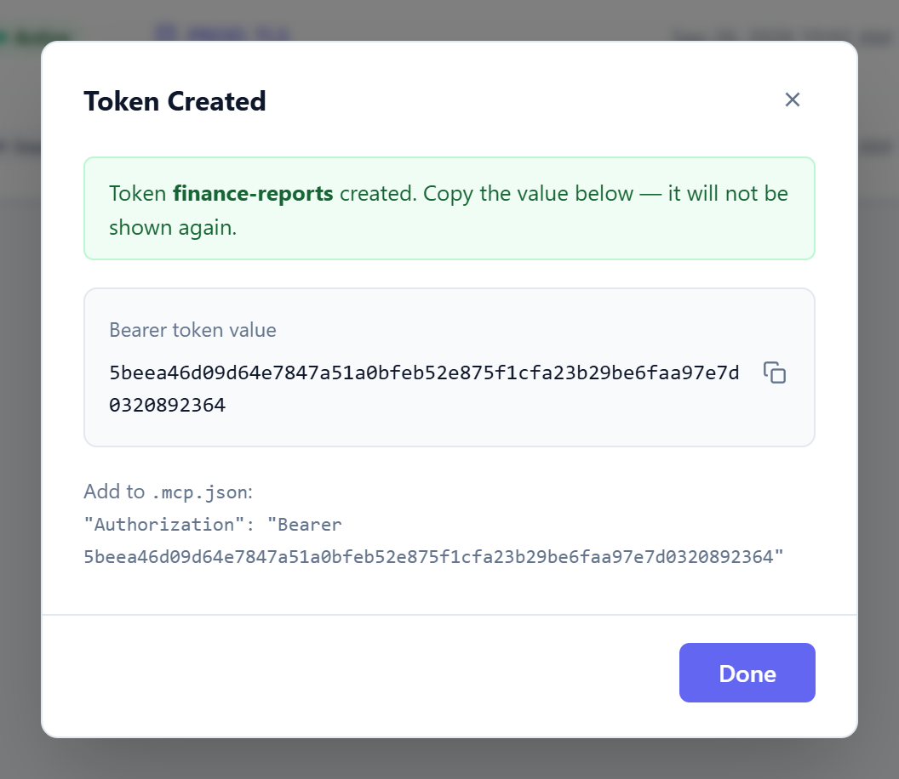</td>
  </tr>
</table>

With OAuth configured, *Sign in with single sign-on* logs in members of an admin group/user, and the section
**OAuth assignments** maps groups or e-mails to a default connection, client-connection mode and the admin role
(assignments from environment variables are listed read-only).

Editing a token changes its name, active state or connection; passwords are never shown and stay unchanged when
the field is left empty. Deleting a token revokes access immediately.

### Admin UI branding

The admin UI can be switched to a corporate design without rebuilding the image:

| Variable | Effect |
|----------|--------|
| `ADMIN_LOGO` | Replaces the database icon on the login card and in the header. A file is embedded as data URI (`.svg`, `.png`, `.jpg`, `.gif`, `.webp`); an `http(s)://` URL is used as is (the browser must be able to reach it). |
| `ADMIN_THEME_CSS` | Stylesheet injected after the built-in styles. Override the CSS variables below; any other CSS rule is allowed, too. |
| `MCP_SERVER_NAME` | Title next to the logo and in the browser tab. |

Both files are read once at startup; an unreadable file is logged as `[WARN] [CONFIG]` and the built-in design is
used. The design is served to everyone who opens `/admin` (also before sign-in), so do not put anything
confidential into it.

All colors of the UI are CSS variables in the `:root` block at the top of [`admin.html`](admin.html):

| Variable | Used for |
|----------|----------|
| `--primary`, `--primary-dk`, `--on-primary` | Buttons, links, toggles; hover color; text on primary |
| `--border-focus`, `--focus-ring` | Focused inputs |
| `--header-bg`, `--header-text`, `--header-muted`, `--header-border`, `--header-hover` | Top bar and its buttons |
| `--brand-from`, `--brand-to` | Gradient of the built-in icon (without `ADMIN_LOGO`) |
| `--bg`, `--surface`, `--surface-alt`, `--row-hover`, `--border`, `--border-light` | Page, cards, table header, rows |
| `--text`, `--text-muted`, `--text-faint` | Text colors |
| `--success*`, `--danger*`, `--toggle-off` | Status badges, alerts, delete dialog, switched-off toggles |
| `--font`, `--radius` | Font stack, corner radius of cards and dialogs |
| `--logo-height`, `--header-logo-height` | Logo height on the login card (40px) and in the header (28px) |

[`examples/admin-theme/`](examples/admin-theme) contains a complete example (fictional "ACME data" design: light
header with accent bar, teal primary color, own logo):

```css
:root {
  --primary:      #00857c;
  --primary-dk:   #006b63;
  --header-bg:    #ffffff;
  --header-text:  #12333a;
  --font:         "Segoe UI", Arial, Helvetica, sans-serif;
}
header { border-bottom: 3px solid #f2a900; }   /* additional rules are fine */
```

```bash
docker run -d -p 3000:3000 \
  -v "$PWD/examples/admin-theme:/branding:ro" \
  -e ADMIN_THEME_CSS=/branding/theme.css -e ADMIN_LOGO=/branding/logo.svg \
  -e MCP_SERVER_NAME="ACME Oracle MCP" … tommi2day/oracle-mcp-server
```

With Helm put the files into a ConfigMap and set `adminUi.brandingConfigMap`, `adminUi.themeCss` and
`adminUi.logo` (see [values.yaml](helm/oracle-mcp-server/values.yaml)):

```bash
kubectl -n mcp create configmap mcp-branding --from-file=examples/admin-theme/theme.css --from-file=examples/admin-theme/logo.svg
```

<table>
  <tr>
    <td width="70%" valign="top"><b>Token list with the example theme</b><br>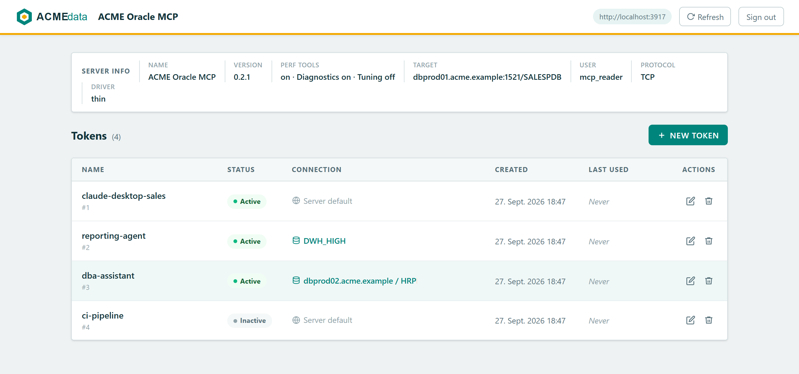</td>
    <td width="30%" valign="top"><b>Login</b><br>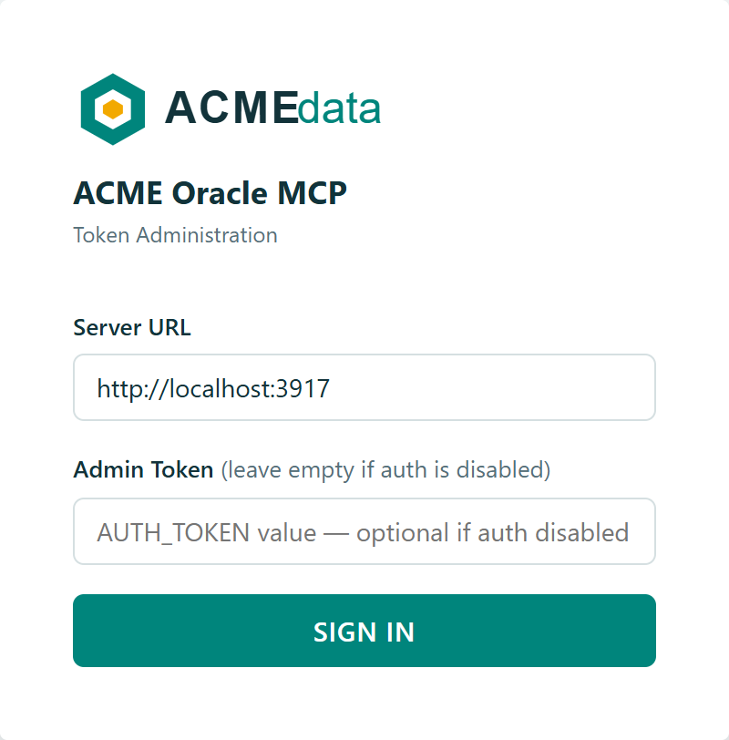</td>
  </tr>
</table>

---

## OAuth 2.0 / OpenID Connect

Instead of (or next to) bearer tokens, users can authenticate with an OpenID Connect provider — primarily **Microsoft
Entra ID**, also Keycloak, Okta and others. Set `OAUTH_ISSUER`; MCP clients then send an OAuth access token (JWT) as
bearer token, which the server validates locally (signature via JWKS, issuer, audience, lifetime).

- **Authorization by assignment (deny by default):** a user may use the server if their e-mail or one of their groups
  is assigned — via `OAUTH_ALLOWED_GROUPS`, `OAUTH_ALLOWED_USERS`, `OAUTH_ADMIN_GROUPS`, `OAUTH_ADMIN_USERS`,
  `OAUTH_ASSIGNMENTS` or in the admin UI (*OAuth assignments*).
- **Default connection by group or e-mail:** an assignment can carry an Oracle connection (TNS alias, host/service,
  user, …) that the user gets; users without one use the server default. `client_connection` lets selected users bring
  their own database account.
- **Attributable:** `CLIENT_IDENTIFIER` in `V$SESSION` and the `[MCP]` / `[SESSION]` log lines carry the user's e-mail;
  `[AUDIT]` lines record logins, MCP sessions and admin changes.
- `AUTH_TOKEN` and file tokens keep working (break-glass admin).

```bash
OAUTH_ISSUER=https://login.microsoftonline.com/<tenant-id>/v2.0
OAUTH_CLIENT_ID=<app-id>  OAUTH_CLIENT_SECRET=<secret>  OAUTH_AUDIENCE=api://<app-id>
OAUTH_PUBLIC_URL=https://mcp.example.com
OAUTH_ADMIN_GROUPS=<admin-group-object-id>  OAUTH_ALLOWED_GROUPS=<user-group-object-id>
```

MCP clients can send such a token as a header or log in by themselves ([client setup](docs/oauth.md#mcp-clients)).
Full reference, Entra setup steps and security notes: [docs/oauth.md](docs/oauth.md).

Users and groups are assigned to connections in the admin UI (*OAuth assignments*):

<table>
  <tr>
    <td width="35%" valign="top"><b>Login with single sign-on</b> next to the token login<br>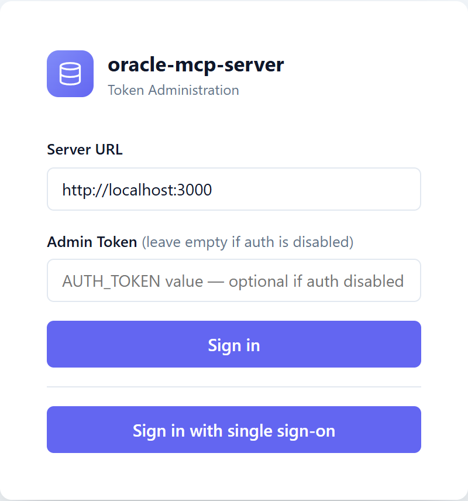</td>
    <td width="65%" valign="top"><b>OAuth assignments</b> — groups and users mapped to a default connection; <i>environment</i> entries come from <code>OAUTH_*</code> and are read-only<br>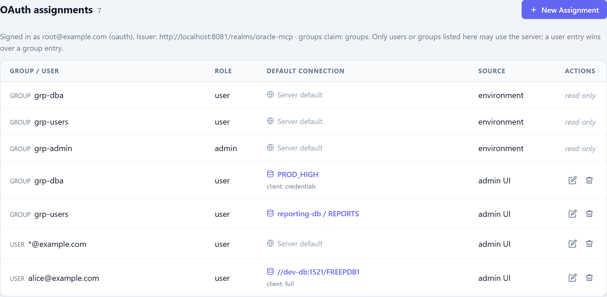</td>
  </tr>
</table>

<details>
<summary>Edit assignment: user, admin role, client-supplied connection and default connection</summary>

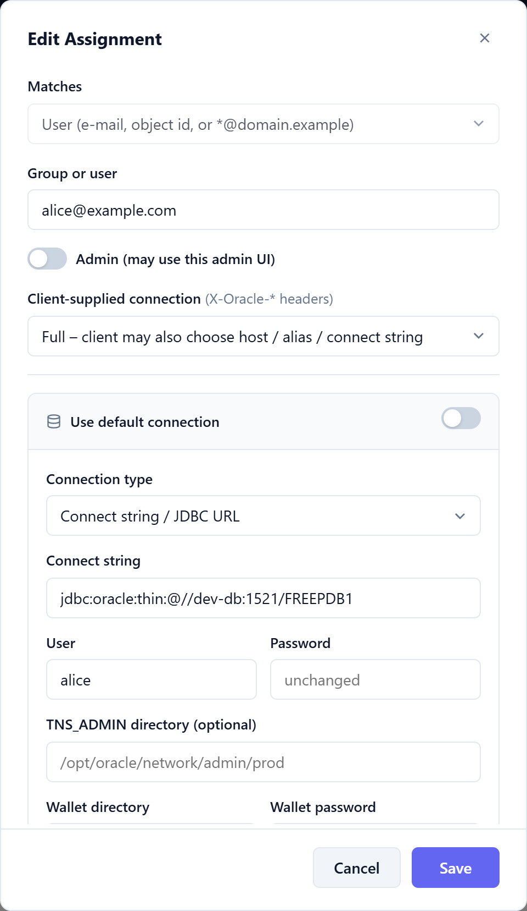

</details>

---

## Logging

All activity goes to stderr (`docker logs oracle-mcp-server`) in the format `[timestamp] [LEVEL] [CATEGORY] …`:
tool calls, MCP session start/stop, rejected logins and admin actions. `LOG_LEVEL` (`debug` / `info` / `warn` /
`error`, default `info`) sets the minimum level.

Real output at the default level `info` — three clients working in parallel (one of them over the TNS alias `FREE`
with the performance tools), an `UPDATE` rejected by the read-only database user of `reporting-team`, and four
rejected logins (disabled token, unknown token, wrong admin token, missing token). SQL text is replaced by its length:

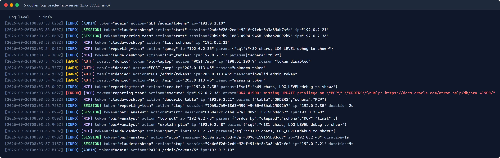

With `LOG_LEVEL=debug` the full SQL text is logged, plus internals such as pool creation:

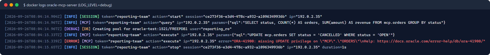

Line format, all categories and keys, and ready-to-use Filebeat / Logstash configurations:
[docs/logging.md](docs/logging.md).

---

## Kubernetes / Helm

The chart is published as an OCI artifact on GitHub Container Registry (one chart version per release, chart
version = app version):

```bash
helm install oracle-mcp oci://ghcr.io/tommi2day/charts/oracle-mcp-server --version 1.0.0 -n mcp …
helm show values oci://ghcr.io/tommi2day/charts/oracle-mcp-server --version 1.0.0
```

Or install from a checkout of this repository:

```bash
kubectl create namespace mcp
kubectl -n mcp create secret generic oracle-tns-admin --from-file=tnsnames.ora --from-file=ewallet.pem
kubectl -n mcp create secret generic oracle-credentials --from-literal=password='secret'

helm install oracle-mcp ./helm/oracle-mcp-server -n mcp \
  --set oracle.tnsAlias=PROD_HIGH --set oracle.user=app \
  --set oracle.existingSecret=oracle-credentials \
  --set tnsAdmin.existingSecret=oracle-tns-admin \
  --set auth.token=$(openssl rand -hex 32) \
  --set persistence.enabled=true
```

Key values (see `helm/oracle-mcp-server/values.yaml`):

- `image.tag` defaults to the chart's `appVersion`, so each chart version deploys its matching image; for thick mode
  use `<version>-thick` (e.g. `1.0.0-thick`), `latest` follows the newest release
- `oracle.connectString` / `oracle.tnsAlias` / `oracle.host|port|serviceName|sid|protocol`, `oracle.user`
- `oracle.password` or `oracle.existingSecret` (keys `password`, optional `walletPassword`)
- `oracle.driverMode` (`thick` requires the `-thick` image), `oracle.sslServerDnMatch`, `oracle.sslServerCertDn`, `oracle.tlsCaFile`
- `oracle.perfTools` (default `true`), `oracle.diagnosticsPack` / `oracle.tuningPack` (default `false`, enable only when licensed)
- `tnsAdmin.existingSecret`, `tnsAdmin.existingConfigMap`, `tnsAdmin.files` (inline) → projected read-only
  volume at `tnsAdmin.mountPath` (mode `0440`, readable through `fsGroup: 1000`)
- `tnsAdmin.extraSecrets` → additional wallet/tnsnames directories for per-token connections
- `auth.token` / `auth.existingSecret`, `auth.storeEncryptionKey`, `server.tlsEnabled`, `tls.*`, `persistence.*`
- `oracle.clientConnection` (`ORA_CLIENT_CONNECTION` for the admin token), `adminUi.*` (branding)

`scripts/helm_install.sh` wraps a typical install.

---

## Claude skills

The `skills/` directory holds [Claude Code skills](docs/skills.md) that use the tools above for typical DBA questions.
They are read-only, base every finding on tool output and use licensed tools (ASH/AWR, SQL Monitor) only when the
server lists them.

| Skill | Ask for … |
|-------|-----------|
| `oracle-db-status` | "What is my database doing?" — health and load at a glance |
| `oracle-top-sessions-sql` | top sessions and top SQL (CPU, time, I/O, executions) |
| `oracle-problem-detection` | locks, deadlocks, waits, saturation, long-running calls |
| `oracle-sql-tuning` | why a statement is slow: plan, statistics, indexes, verified recommendations |
| `oracle-document` | schema / data model documentation (ERD), incident and tuning write-ups |
| `oracle-error-analysis` | ORA- errors: alert log → incident → trace file → cause |

```bash
cp -r skills/* ~/.claude/skills/      # all projects; or <project>/.claude/skills/
```

Windows PowerShell: `Copy-Item -Recurse skills\* $env:USERPROFILE\.claude\skills\`.
The error analysis needs the optional log privileges (`grant_perf_privileges.sql <user> MINIMAL N N Y`). Details,
required privileges and the safety design: [docs/skills.md](docs/skills.md).

---

## Claude configuration

Remote (HTTP):

```json
{
  "mcpServers": {
    "oracle": {
      "type": "http",
      "url": "https://oracle-mcp.example.com/mcp",
      "headers": { "Authorization": "Bearer <token>" }
    }
  }
}
```

With [OAuth](#oauth-20--openid-connect) the client can log in by itself — only the URL is configured, the client
finds the identity provider through the server's `/.well-known/oauth-protected-resource` and refreshes the token:

```json
{ "mcpServers": { "oracle": { "type": "http", "url": "https://oracle-mcp.example.com/mcp" } } }
```

```bash
# Claude Code; the provider needs a pre-registered public client (Entra ID has no dynamic registration)
claude mcp add --transport http --client-id <client-id> oracle https://oracle-mcp.example.com/mcp
```

A static `Authorization: Bearer <access token>` header works as well, but access tokens expire. Provider
requirements (client registration, audience, scopes) and `OAUTH_RESOURCE_SCOPES`: [docs/oauth.md](docs/oauth.md#mcp-clients).

Local (stdio): see `example.mcp.json`. The file also has inactive examples (block `_inactive_examples`, ignored by
clients; copy an entry into `mcpServers` to use it): OAuth login by the client, an OAuth access token as header, and
[client-supplied connections](#client-supplied-connections) with the user's own credentials or a client-chosen database.

---

## Development

```bash
npm ci
npm run build          # tsc → dist/
npm test               # vitest (unit tests, no database needed; integration tests are skipped)
npm run test:integration  # against Docker: Oracle Free + OIDC provider, see below
npm run lint
npm run typecheck
./scripts/test.sh      # tests in Docker, no local Node.js needed
docker build -t oracle-mcp-server .                                   # thin image
docker build --build-arg ORACLE_THICK=true -t oracle-mcp-server:thick .  # with Instant Client
```

Integration tests (real Oracle database and a real OIDC provider, skipped unless the variable is set):

```bash
docker compose --profile oidc up -d oracle-test oidc-test    # wait until oracle-test is healthy
ORA_TEST_HOST=localhost OIDC_TEST_ISSUER=http://localhost:8080/default npm run test:integration
docker compose --profile oidc down
# OIDC tests against a real provider with login form (Keycloak) instead of the mock server:
docker compose --profile keycloak up -d --wait keycloak
OIDC_TEST_ISSUER=http://localhost:8081/realms/oracle-mcp npx vitest run tests/oidc.integration.test.ts
```

To try the admin UI's single sign-on yourself, [docs/oauth.md](docs/oauth.md#trying-it-locally-with-keycloak) starts
the whole stack with a Keycloak realm (admin console, users and groups included).

They run every MCP tool against sample schemas, the [Claude skills](#claude-skills) on real data (blocking chain,
slow statement and index fix, deadlock → alert log → trace file; `tests/skills.test.ts` checks without a database that
skills and tool schemas agree), the OAuth path end to end (group / e-mail → schema, `V$SESSION`
tags, client-supplied credentials, assignment admin API) and the token validation against the provider
([docs/oauth.md](docs/oauth.md#tests)).

Source layout: `src/oracle.ts` (connect strings, JDBC parsing, pool attributes, wallets — pure),
`src/lib.ts` (logging, auth, token store, admin API), `src/oauth.ts` / `src/oauth-routes.ts` (OAuth 2.0 / OIDC), `src/perf.ts` (performance tools and licence gating),
`src/format.ts` (result formatting), `src/index.ts` (MCP tools, HTTP routing, startup).
Log format: see [docs/logging.md](docs/logging.md). Performance tools: [docs/performance.md](docs/performance.md). Claude skills: [docs/skills.md](docs/skills.md).

---

## License

[MIT](LICENSE) © Tommi2Day
