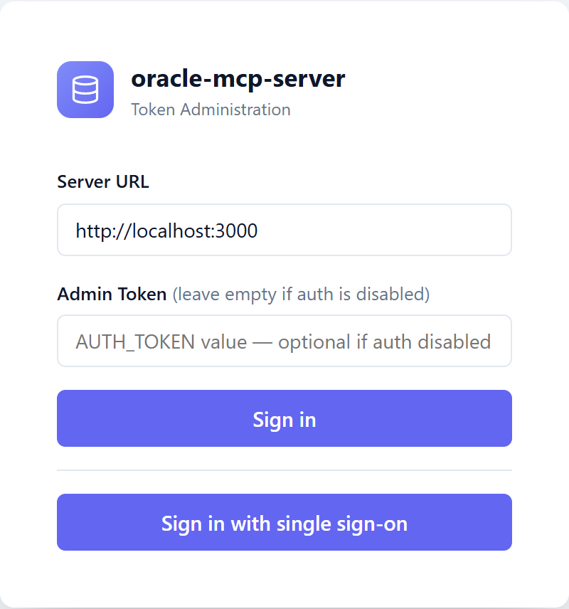
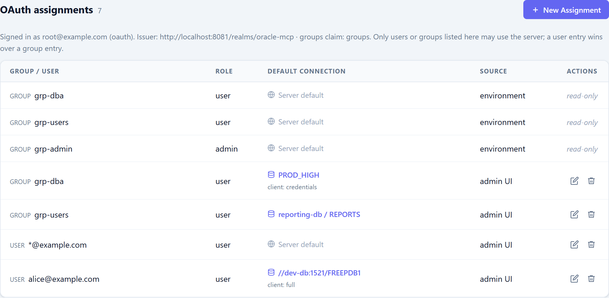
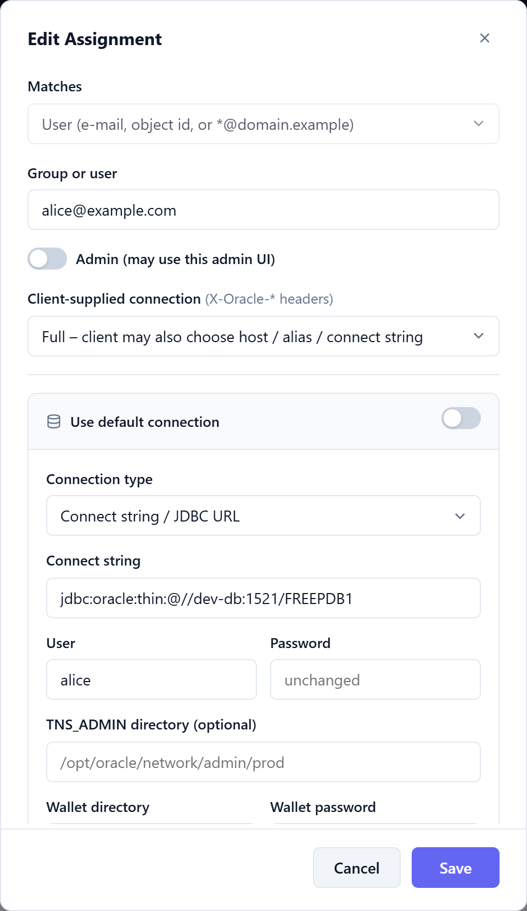

# OAuth 2.0 / OpenID Connect (Microsoft Entra ID and others)

Besides bearer tokens (`AUTH_TOKEN`, file tokens) the server can authenticate users with an OpenID Connect
identity provider — primarily **Microsoft Entra ID**, but any provider that issues signed JWT access tokens
and publishes an OIDC discovery document works (Keycloak, Okta, Auth0, Google, …).

- **MCP clients** send an OAuth access token as `Authorization: Bearer <jwt>`. The server validates signature
  (JWKS of the issuer), issuer, audience and lifetime — no call to the provider per request.
- **Admin UI**: *Sign in with single sign-on* (authorization code flow with PKCE). The browser gets an
  `HttpOnly` session cookie; the admin API also accepts a bearer JWT of an admin.
- **Authorization is deny by default.** A valid token is not enough: the user's e-mail or one of their groups
  must match an **assignment**. The assignment also decides the **default database connection**.
- Every authorized user is **audited** (`[AUDIT]` log lines, `CLIENT_IDENTIFIER` / `MODULE` in `V$SESSION`).
- Bearer tokens keep working next to OAuth; `AUTH_TOKEN` is the break-glass admin access.

OAuth is switched on by `OAUTH_ISSUER`. With OAuth configured and no `AUTH_TOKEN`, authentication is **not**
disabled.

## Configuration (environment variables)

| Variable | Default | Description |
|----------|---------|-------------|
| `OAUTH_ISSUER` | – | Issuer URL; enables OAuth. Entra: `https://login.microsoftonline.com/<tenant-id>/v2.0`. `<issuer>/.well-known/openid-configuration` must exist |
| `OAUTH_AUDIENCE` | `OAUTH_CLIENT_ID` | Accepted `aud` values of access tokens (comma separated), e.g. `api://<app-id>` and/or the app id GUID |
| `OAUTH_CLIENT_ID` | – | App registration used for the admin UI login (and default audience) |
| `OAUTH_CLIENT_SECRET` | – | Client secret for the browser login (omit for public clients; PKCE is always used) |
| `OAUTH_PUBLIC_URL` | – | External base URL, e.g. `https://mcp.example.com`. Redirect URI = `<url>/auth/callback`; `https` also sets the cookie `Secure` flag |
| `OAUTH_RESOURCE_SCOPES` | `<audience>/.default` | Scopes advertised to MCP clients in `/.well-known/oauth-protected-resource` (space or comma separated). The default is right for Entra ID; set it for other providers, e.g. `openid profile email` for Keycloak |
| `OAUTH_REDIRECT_URI` | `<OAUTH_PUBLIC_URL>/auth/callback` | Explicit redirect URI |
| `OAUTH_SCOPES` | `openid profile email` | Scopes of the browser login |
| `OAUTH_GROUPS_CLAIM` | `groups` | Claim with the groups; dotted paths work (`realm_access.roles`); Entra app roles: `roles` |
| `OAUTH_EMAIL_CLAIM` | – | Claim with the e-mail; fallback chain `email`, `preferred_username`, `upn` |
| `OAUTH_ALLOWED_ISSUERS` | `OAUTH_ISSUER` | Accepted `iss` values (comma separated), e.g. Entra v1 tokens `https://sts.windows.net/<tenant>/` |
| `OAUTH_JWKS_URI`, `OAUTH_AUTHORIZATION_ENDPOINT`, `OAUTH_TOKEN_ENDPOINT` | discovery | Override the discovery document |
| `OAUTH_REQUIRE_VERIFIED_EMAIL` | `false` | `true`: only use an e-mail the provider marks `email_verified: true` (an e-mail marked `false` is always ignored). Entra does not send `email_verified`, so leave it off there |
| `OAUTH_SESSION_TTL` | `28800` | Admin UI session lifetime in seconds |
| `OAUTH_ALLOWED_GROUPS` | – | Comma separated groups that may use the server (default connection) |
| `OAUTH_ALLOWED_USERS` | – | Comma separated e-mails (or `*@domain`) that may use the server |
| `OAUTH_ADMIN_GROUPS` / `OAUTH_ADMIN_USERS` | – | Admins: may also use the admin UI and API |
| `OAUTH_ASSIGNMENTS` | – | JSON array of assignments with connections, see below |

Group names and e-mails are compared case-insensitively. Entra puts group **object IDs** (GUIDs) into the token.

## Assignments

In the admin UI (sign in with single sign-on as an admin) the assignments are managed in the section *OAuth assignments*:

<table>
  <tr>
    <td width="35%" valign="top"><b>Login with single sign-on</b> next to the token login<br></td>
    <td width="65%" valign="top"><b>OAuth assignments</b> — groups and users mapped to a default connection; <i>environment</i> entries come from <code>OAUTH_*</code> and are read-only<br></td>
  </tr>
</table>

<details>
<summary>Edit assignment: user, admin role, client-supplied connection and default connection</summary>



</details>

An assignment is `{ "group" | "user", "connection", "client_connection", "admin" }`:

```json
[
  { "group": "11111111-2222-3333-4444-555555555555",
    "connection": { "host": "reporting-db", "service_name": "REPORTS", "user": "ro", "password": "…" } },
  { "user": "alice@example.com", "connection": { "tns_alias": "PROD_HIGH", "user": "app" }, "client_connection": "credentials" },
  { "user": "*@example.com" },
  { "group": "99999999-8888-7777-6666-555555555555", "admin": true }
]
```

`connection` takes the same fields as the connection of a [token](../README.md#tokens--per-token-connections)
(`connect_string`, `tns_alias`, `host` / `port` / `service_name` / `sid` / `protocol`, `user`, `password`, wallet and
TLS fields, `diagnostics_pack`, `tuning_pack`).

- **Access**: a user may use `/mcp` if at least one assignment matches their e-mail or one of their groups.
- **Default connection**: without `X-Oracle-*` headers the user gets the connection of the best matching assignment
  that defines one: exact e-mail, then `*@domain`, then groups in list order (environment first, then the ones
  created in the admin UI). Without any, the server default (`ORA_*`) is used. Missing connection fields fall back
  to `ORA_*` as for tokens (a target — `connect_string`, `tns_alias` or `host` — is always taken as a whole, and
  `user` / `password` only fall back if the assignment sets no `user`).
- **`client_connection`** (`none` default, `credentials`, `full`) works as for tokens: it controls whether the user
  may override the connection with `X-Oracle-*` headers on the `initialize` request
  ([README](../README.md#client-supplied-connections)).
- **User by object id:** `user` may also be the immutable object id (Entra `oid`, otherwise `sub`), e.g.
  `{ "user": "0f9c1c2e-…", "admin": true }`. Prefer this for admins: e-mail, `preferred_username` and `upn` are
  mutable attributes — keep `OAUTH_ALLOWED_ISSUERS` to your own tenant and don't trust e-mail matching with
  multi-tenant issuers.
- **`admin: true`**: the user may also use the admin UI/API.
- **Where**: `OAUTH_ALLOWED_*`, `OAUTH_ADMIN_*` and `OAUTH_ASSIGNMENTS` (read-only in the admin UI, shown as
  *environment*) and the **admin UI** (section *OAuth assignments*, REST `/admin/assignments`; stored in the token
  store file, `password` / `wallet_password` encrypted with `STORE_ENCRYPTION_KEY`, never returned by the API).
  Changes apply immediately, also to open sessions of the admin UI. Open MCP sessions keep their pool; the next
  session uses the new connection.

From the command line (scripts/provisioning; `AUTH_TOKEN` or the access token of an admin):

```bash
export AUTH_TOKEN=<admin token or access token of an OAuth admin> MCP_URL=http://localhost:3000
./scripts/admincli.sh whoami                       # who am I, is OAuth configured
./scripts/admincli.sh add-assignment --group grp-dba --tns-alias PROD_HIGH --user mcp_dba --password secret
./scripts/admincli.sh add-assignment --email alice@example.com --client-connection credentials
./scripts/admincli.sh add-assignment --email '*@example.com'      # access with the default connection
./scripts/admincli.sh add-assignment --group grp-admin --admin    # may use the admin UI and API
./scripts/admincli.sh list-assignments
./scripts/admincli.sh set-assignment-conn 2 '{"host":"db2","service_name":"PDB1","user":"ro","password":"…"}'
./scripts/admincli.sh delete-assignment 2
```

`admincli.sh` takes the same connection options as `add-token`; `--group` / `--email` (e-mail, object id or `*@domain`) name
who the assignment is for. Assignments from the environment (`OAUTH_*`) are listed as read-only. `help` shows all commands.

## MCP clients

Nothing OAuth-specific is needed in the client configuration unless you want the client to log in by itself. There
are two ways to get the access token to the server:

**1. Static header** — works with every client. The token is an access token of your provider; it expires (Keycloak
test realm: 5 minutes, Entra: about an hour), so this suits scripts and tests, or clients and wrappers that refresh it.

```json
{ "mcpServers": { "oracle": { "type": "http", "url": "https://mcp.example.com/mcp",
    "headers": { "Authorization": "Bearer <access token>" } } } }
```

**2. The client does the OAuth login** — for people. Clients that implement the MCP authorization spec (Claude Code,
Claude Desktop / claude.ai connectors, VS Code, …) need only the URL; they open a browser login and refresh the token
themselves:

```json
{ "mcpServers": { "oracle": { "type": "http", "url": "https://mcp.example.com/mcp" } } }
```

How it works: an unauthenticated request gets `401` with `resource_metadata` (needs `OAUTH_PUBLIC_URL`); the client
reads `/.well-known/oauth-protected-resource`, finds the issuer in `authorization_servers`, requests the
`scopes_supported` (**`OAUTH_RESOURCE_SCOPES`**) and runs authorization code + PKCE against the provider. The server
is only the resource server; the provider issues the tokens. What the provider side needs:

| Need | Details |
|------|---------|
| **Client registration** | The client needs a client id at the provider: either *Dynamic Client Registration* (Keycloak supports it, often restricted by policy; **Entra ID does not**) or a **pre-registered public client** (PKCE, no secret) whose id you give to the client: `claude mcp add --transport http --client-id <id> oracle https://mcp.example.com/mcp` (add `--client-secret` for a confidential client). Allow the client's redirect URIs, e.g. `http://localhost:<port>/callback` (Claude Code), `https://claude.ai/api/mcp/auth_callback` (claude.ai) |
| **Audience** | The access token must carry `aud` = `OAUTH_AUDIENCE`. Entra: the client requests the scope `api://<app-id>/<scope>` (`OAUTH_RESOURCE_SCOPES` default `api://<app-id>/.default`) and the app registration lists the client as authorized. Keycloak: an *Audience* mapper on the client (or a client scope the client requests) |
| **Groups / e-mail** | The groups claim (`OAUTH_GROUPS_CLAIM`) and `email` must be in the **access token**: Keycloak *Group Membership* mapper, Entra *groups claim* / optional claim `email` |
| **Scopes** | `OAUTH_RESOURCE_SCOPES` must name scopes the provider knows. Entra: leave the default. Keycloak: `openid profile email` (there is no `api://…/.default`) |

The user must also match an [assignment](#assignments); a valid login without one gets `403`.

The Keycloak test realm contains such a pre-registered client, `oramcp-mcp-client`, and
`tests/oidc.integration.test.ts` plays the client's part (authorization code + PKCE, then the token against the server).
Not covered: a real MCP client end to end (browser, token refresh, dynamic registration).

## Microsoft Entra ID setup

1. **App registration** *(Entra admin center → App registrations → New)*: single tenant. Note *Application (client) ID*
   and *Directory (tenant) ID*.
2. **Expose an API**: Application ID URI `api://<client-id>` and a scope (e.g. `access`). MCP clients request tokens
   for this audience: `OAUTH_AUDIENCE=api://<client-id>`. In the app manifest set
   `"requestedAccessTokenVersion": 2` (v2 tokens: issuer `https://login.microsoftonline.com/<tenant>/v2.0`).
3. **Groups in the token** *(Token configuration → Add groups claim)*: choose *Groups assigned to the application*
   (recommended: avoids the 200 group limit, only relevant groups appear). Assign the groups under
   *Enterprise applications → Users and groups*. Select *Group ID* as the claim value. For **Entra tokens
   with more than 200 groups** only a pointer is issued; the server cannot resolve it and denies with a hint in
   the log — use *assigned groups* or app roles (`OAUTH_GROUPS_CLAIM=roles`).
4. **E-mail**: add the optional claim `email` to ID and access tokens (otherwise `preferred_username`, normally the UPN,
   is used).
5. **Admin UI login** *(Authentication → Add platform → Web)*: redirect URI `https://mcp.example.com/auth/callback`,
   create a client secret → `OAUTH_CLIENT_SECRET`.
6. Server:

```bash
OAUTH_ISSUER=https://login.microsoftonline.com/<tenant-id>/v2.0
OAUTH_CLIENT_ID=<client-id>
OAUTH_CLIENT_SECRET=<secret>
OAUTH_AUDIENCE=api://<client-id>
OAUTH_PUBLIC_URL=https://mcp.example.com
OAUTH_ADMIN_GROUPS=<group-object-id-of-the-mcp-admins>
OAUTH_ALLOWED_GROUPS=<group-object-id-of-all-mcp-users>
```

Other providers: set `OAUTH_ISSUER` to the issuer, make sure `aud` matches `OAUTH_AUDIENCE` and put the roles/groups into a
claim named by `OAUTH_GROUPS_CLAIM` (Keycloak: `realm_access.roles` or a *Group Membership* mapper named `groups`).

MCP clients that do the OAuth dance themselves find the authorization server through
`GET /.well-known/oauth-protected-resource` (RFC 9728, needs `OAUTH_PUBLIC_URL`); the `401` carries the matching
`resource_metadata` in `WWW-Authenticate`. Clients with a static header just send the token.

## Audit

Everything an OAuth user does is attributable:

| Where | What |
|-------|------|
| `[AUDIT]` log | `login` / `logout` of the admin UI, `session_start` of every MCP session (with `assignment` and `admin`), every changing admin API call (`via="oauth-admin"`) — user e-mail and subject (`oid`) |
| `[MCP]`, `[SESSION]`, `[ADMIN]` logs | `token="<e-mail>"` — the e-mail takes the place of the token name in every line |
| `[AUTH]` log | denied requests with reason (`oauth: token expired`, `oauth: no assignment for this user or groups`, `oauth: audience not accepted`, …); tokens are never logged |
| Oracle | `V$SESSION.CLIENT_IDENTIFIER` = e-mail (64 bytes), `MODULE` = `MCP_SERVER_NAME`, `ACTION` = tool name, set on every connection checkout ([session identification](../README.md#session-identification)) → `V$SESSION`, `SYS_CONTEXT('USERENV','CLIENT_IDENTIFIER')`, unified auditing (`UNIFIED_AUDIT_TRAIL.CLIENT_IDENTIFIER`) |

Formats: [logging.md](logging.md). Group ids are not logged (only the id of the matched assignment).

## Security notes

- Tokens are verified with the issuer's public keys (RS/PS/ES algorithms; `none` and HMAC are refused); keys are cached and
  re-read when an unknown `kid` appears (at most every 30 s).
- Admin UI sessions are server-side (lost on restart), `HttpOnly`, `SameSite=Lax`, `Secure` with an https
  `OAUTH_PUBLIC_URL`. State-changing requests with the cookie need an `X-Requested-With` header (CSRF). Login uses
  PKCE, `state` and `nonce`. Group changes in the provider apply at the next login or token.
- Use HTTPS (`TLS_ENABLED` or an ingress): bearer tokens and the session cookie must not travel in clear text.
- Users whose assignments resolve to the same effective connection share one connection pool; the user is
  identified per checkout through `CLIENT_IDENTIFIER`, not through the pool.

## Trying it locally with Keycloak

The compose file has a `keycloak` profile with a real provider — admin console, login page, REST API — and a
ready-made realm (`tests/oidc/keycloak-realm.json`, imported at startup): users `alice` (group `grp-dba`), `bob`
(`grp-users`), `eve` (`grp-other`, no assignment) and `root` (`grp-admin`), password = user name; client `oramcp-web`
(admin UI login, authorization code + PKCE), `oramcp-mcp-client` (public, PKCE: the pre-registered client for MCP
clients that log in themselves, see [MCP clients](#mcp-clients)) and `oramcp-test` (password grant, to get access
tokens with `curl`).
Groups come from a *Group Membership* mapper (claim `groups`), the audience `api://oracle-mcp` from an *Audience* mapper.

```bash
docker compose --env-file examples/oauth-keycloak.env --profile keycloak up -d --build
# Admin UI:  http://localhost:3000/admin  → "Sign in with single sign-on"  (root / root is an admin)
# Keycloak:  http://localhost:8081        (admin / admin: add users and groups, change mappers)
# Claude Code logging in by itself:
#   claude mcp add --transport http --client-id oramcp-mcp-client oracle http://localhost:3000/mcp
TOKEN=$(curl -s -X POST http://localhost:8081/realms/oracle-mcp/protocol/openid-connect/token   -d grant_type=password -d client_id=oramcp-test -d username=alice -d password=alice | jq -r .access_token)
```

`examples/oauth-keycloak.env` sets `OAUTH_AUTHORIZATION_ENDPOINT`, `OAUTH_TOKEN_ENDPOINT` and `OAUTH_JWKS_URI`
explicitly: the browser knows Keycloak as `localhost:8081` (which is also the token issuer), the server container as
`keycloak:8080`. More users: the admin console, or `kcadm.sh` / the Keycloak admin REST API against the running container.

## Tests

- `tests/oauth.test.ts`, `tests/oauth-auth.test.ts`: JWT validation, assignments, login flow, admin API, audit — with a
  fake provider (generated RSA/EC keys, stubbed `fetch`); run with `npm test`.
- Integration tests run against Docker containers and are skipped unless their environment variable is set
  (`npm run test:integration` with the containers up):

```bash
docker compose --profile oidc up -d oracle-test oidc-test   # Oracle Free + ghcr.io/navikt/mock-oauth2-server (users in tests/oidc/)
ORA_TEST_HOST=localhost OIDC_TEST_ISSUER=http://localhost:8080/default npm run test:integration
docker compose --profile oidc down
```

  - `tests/oidc.integration.test.ts` (`OIDC_TEST_ISSUER`): a real provider issues the tokens — JWKS validation, forged
    payload, audience, groups → connection, admin group, browser login with PKCE. It runs against either the mock
    server (`http://localhost:8080/default`, fast) or Keycloak (`docker compose --profile keycloak up -d --wait
    keycloak`, `OIDC_TEST_ISSUER=http://localhost:8081/realms/oracle-mcp`): there the browser login goes through the
    real login form, and a wrong password, verified e-mails and `OAUTH_REQUIRE_VERIFIED_EMAIL=true` are checked too.
  - `tests/oracle.integration.test.ts` (`ORA_TEST_HOST`, optional `ORA_TEST_PORT`, `ORA_TEST_SERVICE`,
    `ORA_TEST_ADMIN_USER` / `ORA_TEST_ADMIN_PASSWORD`, default `system` / `manager`) checks the whole path with a real
    Oracle database: every MCP tool, the group of a user selects the schema, `V$SESSION` shows `CLIENT_IDENTIFIER` =
    e-mail, client-supplied credentials are enforced by Oracle, the admin API manages assignments.
