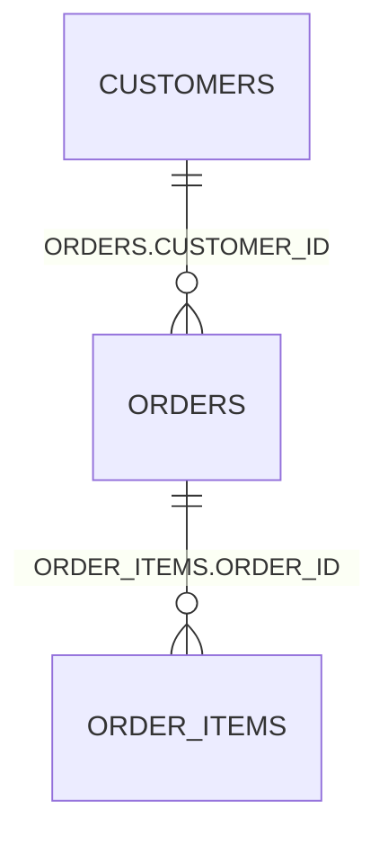

# Claude skills for Oracle analysis

The `skills/` directory contains [Claude Code skills](https://docs.claude.com/en/docs/claude-code/skills): one
`SKILL.md` per workflow. They tell Claude *how* to use the MCP tools of this server for a task — which tool to call
first, how to read the result, what to report — so the answers are consistent and evidence-based.

| Skill | Use it for | Main tools |
|-------|-----------|------------|
| [`oracle-db-status`](../skills/oracle-db-status/SKILL.md) | "What is my database doing?", health and load at a glance | `test_connection`, `db_overview`, then the tool the findings point to |
| [`oracle-top-sessions-sql`](../skills/oracle-top-sessions-sql/SKILL.md) | Top sessions and top SQL: who and what consumes CPU, time, I/O | `session_activity`, `top_sql`, `ash_top`¹ |
| [`oracle-problem-detection`](../skills/oracle-problem-detection/SKILL.md) | Locks, deadlocks, wait events, saturation, long calls, stale statistics | `db_overview`, `locks`, `session_activity`, `alert_log`, `table_stats`, `ash_top`¹ |
| [`oracle-sql-tuning`](../skills/oracle-sql-tuning/SKILL.md) | Slow statements: plan reading, estimates vs. actual rows, statistics, indexes, verified recommendations | `top_sql`, `sql_plan`, `explain_plan`, `table_stats`, `query`, `sql_monitor`² |
| [`oracle-document`](../skills/oracle-document/SKILL.md) | Document a schema / data model (ERD, dictionary), or write up a diagnosis, tuning result or incident | `list_tables`, `describe_table`, `table_stats`, `query` |
| [`oracle-error-analysis`](../skills/oracle-error-analysis/SKILL.md) | ORA- errors, crashes, deadlocks: alert log → incident → trace file → statement → cause | `alert_log`, `incidents`, `trace_files`, `trace_content`, `sql_plan` |

¹ Diagnostics Pack, ² Tuning Pack — only used when the tool is enabled on the server (`ORA_DIAGNOSTICS_PACK`,
`ORA_TUNING_PACK` or the token's `diagnostics_pack` / `tuning_pack`); the skills never try licensed tools that are not listed.

## Install

Skills are plain directories. Copy or link them into one of the places Claude Code reads:

```bash
# for all your projects
cp -r skills/* ~/.claude/skills/

# or for one project (committed with the project)
mkdir -p .claude/skills && cp -r skills/* .claude/skills/
```

On Windows PowerShell: `Copy-Item -Recurse skills\* $env:USERPROFILE\.claude\skills\`.
Claude picks a skill by its `description` — ask naturally ("what is my Oracle database doing?", "why is this query
slow?") or invoke one explicitly with `/oracle-sql-tuning`.

The MCP server itself must be connected (see [Claude configuration](../README.md#claude-configuration)); the skills
use whatever name you gave it (`mcp__<server>__<tool>`).

## Using the skills — examples

Ask in plain language; Claude picks the skill from its description. You can also name it (`/oracle-sql-tuning …`) or
mention the skill in the prompt. The examples below were produced by running each skill's workflow against an Oracle
Database 23ai Free test schema (`SHOP`: `CUSTOMERS`, `ORDERS`, `ORDER_ITEMS`) with a missing index, a forgotten commit and a
deadlock built in. Output excerpts are real and shortened; the "answer" is the shape the skill asks for, condensed.

### 1. "What is my database doing right now?" — `oracle-db-status`

```text
You:    What is my Oracle database doing right now?
Claude: test_connection → db_overview → locks (because db_overview flagged a blocked session)
```

Key output of `db_overview`:

```text
Instance FREE (23.0.0.0.0, OPEN) — container FREEPDB1
Load, last minute:  Average Active Sessions 0.47 · Database CPU Time Ratio 99.91 % · Executions/s 18.85
User sessions: 2 total, 1 active, 1 blocked, longest active call 5 s
Active sessions by CPU / wait class:  Application 1
Attention:
- 1 session(s) are blocked → run the locks tool.
```

Answer: **Verdict: degraded.** The instance is idle apart from one session waiting in wait class *Application* — it has been
blocked for 5 s by another session (SID 50, idle). Next: `oracle-problem-detection` for the blocker.

### 2. "Which SQL costs the most?" — `oracle-top-sessions-sql`

```text
You:    Show me the top SQL, and tell me which of it is actually worth tuning.
Claude: top_sql by elapsed, executions, buffer_gets and elapsed_per_exec; session_activity
```

```text
SQL_ID         EXECS  ELAPSED_S  CPU_S  MS/EXEC  GETS  SQL_TEXT
gmtsmnmj3vn9t      1       3.18   0.17  3183.97     4  UPDATE t_dead SET v='A2' WHERE id=2
7p0x6ramg3sc3     12       0.04   0.03     3.62 12366  SELECT o.id, c.name, o.total FROM orders o JOIN customers c …
6nkv3sb3dgw6d    300          0      0     0.02   905  SELECT name FROM customers WHERE id = :1
```

Answer: the first statement is **not** a tuning candidate: 3.18 s elapsed but 0.17 s CPU and 4 buffer gets — it waited for a
lock (see problem detection / error analysis). The report query returns ~164 rows for ~1000 buffer gets per execution — a
full scan for a selective filter, worth tuning. The `customers` lookup is frequent but cheap (0.02 ms), leave it.

### 3. "Sessions hang in the web shop" — `oracle-problem-detection`

```text
You:    Users of the web shop say orders can't be updated. Is something blocking?
Claude: db_overview → locks → (alert_log for deadlocks, table_stats for the tables involved)
```

```text
Blocked sessions (1):
SID  SERIAL#  USER  EVENT                          WAIT_S  BLOCKER  ROOT  LOCKED_OBJECT  MODULE
 16    27369  SHOP  enq: TX - row lock contention     5.4       50    50  SHOP.ORDERS    web-shop

Root blockers:
SID  SERIAL#  USER  STATUS    CALL_S  WAITERS  PREV_SQL_ID    MACHINE  MODULE
 50    39819  SHOP  INACTIVE       5        1  4hr7nrtzx9vdm  g16      nightly-batch

Diagnosis:
- SID 50 is INACTIVE for 5 s while holding locks: an uncommitted transaction in an idle client …
Last resort, only after the owner agreed (NOT executed by this tool):
  ALTER SYSTEM KILL SESSION '50,39819' IMMEDIATE;
```

Answer: **Problem — blocking lock.** Session 50 (module *nightly-batch*) updated an `ORDERS` row and is idle without committing; the
web-shop session (16) waits on that row. Likely cause: a missing commit in the batch job. Action: the batch owner commits or rolls
back; killing session 50 is possible but loses its uncommitted work — only with their agreement. Claude does not run the kill statement.

### 4. "This query is slow" — `oracle-sql-tuning`

```text
You:    The monthly report query on ORDERS is slow — SELECT … WHERE o.status = 'OPEN' AND o.order_date > SYSDATE - 30. Tune it.
Claude: top_sql (find the sql_id) → sql_plan → query with GATHER_PLAN_STATISTICS → sql_plan "ALLSTATS LAST" → table_stats
```

Before — estimated vs. actual rows (`ALLSTATS LAST`):

```text
| Id | Operation          | Name   | Starts | E-Rows | A-Rows | Buffers |
|  2 |   TABLE ACCESS FULL| ORDERS |      1 |   5494 |    164 |     960 |      filter(STATUS='OPEN' AND ORDER_DATE > SYSDATE-30)
```

`table_stats` shows `STATUS` has 3 distinct values and **no histogram**, and `ORDERS` has only the primary-key index.

Recommendation (Claude proposes, you run):

```sql
BEGIN DBMS_STATS.GATHER_TABLE_STATS(USER, 'ORDERS', method_opt => 'FOR COLUMNS STATUS SIZE 254', cascade => TRUE); END;
CREATE INDEX orders_status_date_ix ON orders (status, order_date);
```

After you applied it — verification with `table_stats` and `explain_plan`:

```text
STATUS  histogram FREQUENCY
| Id | Operation                            | Name                  | Rows | Cost |
|  2 |   TABLE ACCESS BY INDEX ROWID BATCHED| ORDERS                |  165 |  168 |
|* 3 |    INDEX RANGE SCAN                  | ORDERS_STATUS_DATE_IX |  165 |    3 |
```

Estimate 165 rows against 164 actual, index access instead of a full scan, total cost 283 → 177. Claude states what it measured
and what it only expects (real elapsed time should be re-measured by running the report).

### 5. "Document this schema" — `oracle-document`

```text
You:    Document the SHOP schema as docs/shop-schema.md, with an ER diagram and anything that looks wrong.
Claude: list_tables → describe_table per table → query (foreign keys, FKs without index) → table_stats → writes the file after you confirm the path
```

From the dictionary:

```text
TABLE_NAME   CONSTRAINT_NAME  COLUMN_NAME  REF_TABLE  REF_COLUMN
ORDERS       SYS_C008723      CUSTOMER_ID  CUSTOMERS  ID
ORDER_ITEMS  SYS_C008726      ORDER_ID     ORDERS     ID
FK without leading index:  ORDERS (CUSTOMER_ID)
```

The document the skill asks for has an overview, a Mermaid diagram, one section per table (columns with the comments from the
database such as *"OPEN, SHIPPED or CLOSED"*, keys, indexes, approximate row counts) and an *Observations* section:

````markdown

**Observations:** foreign key `ORDERS.CUSTOMER_ID` has no index (joins and deletes on `CUSTOMERS` scan `ORDERS`; common cause of
TM lock waits); `ORDER_ITEMS`, `ORDERS.ORDER_DATE`, `ORDER_ITEMS.PRICE` have no comments.
````

No data values are copied into the document. The same skill writes post-mortems: *"Write up the deadlock we just analysed as an
incident report"* produces summary, timeline, evidence (error codes, trace file name, no data), root cause, actions and prevention.

### 6. "We got ORA-00060 earlier — what happened?" — `oracle-error-analysis`

```text
You:    Our order service reported ORA-00060 around 15:51. What happened, and who is at fault?
Claude: alert_log (errors_only) → incidents → trace_files (name from the alert log) → trace_content (head / "Deadlock graph" with context)
```

```text
TIME                        TRACE_FILE        MESSAGE
2026-11-07 15:51:49 +00:00  FREE_ora_273.trc  ORA-00060: Deadlock detected. … More info in file …/FREE_ora_273.trc.
Incidents: none in the last 7 days.            (a deadlock writes a trace file, not an incident)
```

`trace_content` with `contains: "Deadlock graph"`, `context: 14`:

```text
Deadlock graph:
                                     ------------Blocker(s)-----------  ------------Waiter(s)------------
Resource Name                        process session holds waits serial  process session holds waits serial
TX-00020012-000002B9-BDAECB76-…            91     216     X        23589      92      50           X  13223
TX-0005000E-00000262-BDAECB76-…            92      50     X        13223      91     216           X  23589
Session 216: Holds resource TX-00020012-… acquired 3 seconds ago.   sid: 216 ser: 23589 user: SHOP
```

A second call with `contains: "UPDATE"` shows the statements involved. Answer: **confirmed — a transaction deadlock caused by the
application, not a database fault.** Two sessions (216 and 50) each hold a row the other wants. Probable cause (inferred from the graph,
not visible in the trace): the two code paths touch the same rows in a different order. Oracle rolled back one statement as designed; no
Oracle Support case is needed. Fix: update rows in a fixed order in both services, or lock them up front. Not visible here: the
application logs of the two services.

### Prompts that work well

| Instead of … | Say … |
|--------------|-------|
| "check the db" | "What is my Oracle database doing right now? Anything blocked or failing?" |
| "why slow" | "Why is the statement with sql_id `7p0x6ramg3sc3` slow? Tune it, but don't change anything." |
| "errors?" | "Check the alert log of the last 6 hours for errors and tell me which need action." |
| "document" | "Document schema `HR` (tables `EMP_*` only) with an ER diagram, save it as `docs/hr.md`." |
| "fix the lock" | "Is anything blocking? If so, who and why — and what are my options?" (Claude proposes, you decide.) |

Claude never changes the database on its own initiative: it proposes statements (statistics, indexes, `KILL SESSION`) with risk and
rollback, and runs nothing but the read-only tools unless you explicitly ask it to.

## What the skills need on the database side

| Skill | Privileges |
|-------|-----------|
| status, top sessions/SQL, problem detection (without logs), SQL tuning | the standard performance privileges: `grant_perf_privileges.sql <user>` |
| error analysis, and the alert-log part of problem detection | additionally the log role: `grant_perf_privileges.sql <user> MINIMAL N N Y` (`MCP_PERF_LOG_ROLE`) |
| documentation | none beyond reading the schema (`ALL_*` views) |

Details and the view list per tool: [performance.md](performance.md#required-database-privileges). Without a
privilege a skill reports what it could not check instead of guessing.

## Safety design

- **Read-only.** The skills never use `execute`. Statements with side effects (`ALTER SYSTEM KILL SESSION`,
  `DBMS_STATS`, DDL, SQL plan baselines) are only *proposed* with risk and rollback; the `locks` tool prints the
  kill statement but never runs it.
- **Evidence.** Every finding must come from a tool result; unknowns and unchecked areas are listed explicitly.
- **Sensitive data.** Trace files can contain SQL text and data values; the skills read as little as needed and
  keep values out of answers and documents.
- **Licences.** Pack-licensed tools are used only if the server lists them.

## Maintaining the skills

`skills/*/SKILL.md` reference tool names and parameters of `src/perf.ts`. When a tool changes, update the skill and
this page in the same commit. The skill text is guidance for the model, not code — keep it short, concrete and
free of environment-specific names.
